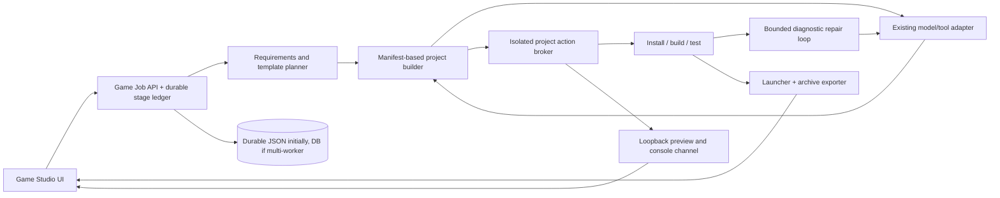

# AgentHub Game Studio Readiness Assessment

**Assessment date:** 2026-10-28  
**Scope:** Architecture/readiness only. No Game Studio or application features were implemented.

This assessment distinguishes the Next.js dashboard from the independent `lmstudio-local-agent` MCP server and its projects. The same repository contains useful game-development examples and workflows, but their presence does not mean they are integrated into AgentHub’s dashboard.

## 1. Objective and scope

Target: a local-first workflow that turns a game request into an inspectable, checkpointed project, writes code/assets, validates dependencies, builds/tests, repairs observed errors, previews safely, creates Windows launchers, and packages the result. Target examples are Desk Racer (React/Vite/Three.js with modular scene, physics and audio) and Wizard Chess 3D (React/Vite/Three.js with centralized chess logic and bundled 3D models).

Confirmed repository examples exist under `lmstudio-local-agent/workspace/projects/desk-racer/` and `wizard-chess-3d/`. Their code/assets are sample project data, not dashboard components. The Python MCP workspace agent is a separate process and requires its configured MCP host; it is not called by the Next.js Sessions UI.

## 2. Existing reusable architecture

| Reusable module/example | What it already offers | Readiness / boundary |
|---|---|---|
| Dashboard Sessions: `src/lib/agent-hub/session/{runner,model,tools,permissions,runtime,store,workspaces}.ts` | Prompt/tool loop, local/custom model selection, text file read/write/edit/delete, command execution, session workspace grants, per-action approvals, SSE progress, stop, saved turns. | Best web-app foundation for an interactive game task, but no durable run queue, full project preview, binary handling, package transaction or archive. |
| Workspace services: `workspace-files.ts`, `workspace-exec.ts`, `workspace-result.ts` | Shared root-scoped file and command APIs, bounded output, path/symlink guards, policy checks. | Reuse contracts after strengthening isolation and adding binary/project action methods. Existing shell is host-level trusted execution. |
| Model transport: `llm.ts`, `session/model.ts` | OpenAI-compatible LM Studio/Ollama/custom HTTP, streaming, tool-call parsing/fallback, usage tracking and stop signal. | Reusable with short contextual actions and checkpointing; local model quality/latency is variable. |
| Skills registry | Existing validated instruction packs, metadata, compatibility and skill reads. | Reuse for optional game-design/Three.js/testing workflows. Skills remain untrusted instructions, not executable plugins. The MCP game skills are currently a separate collection. |
| Installed game skills under `.agenthub/skills/` | Existing `game-design`, `web-game-development`, `web-3d-game-development`, `game-physics`, `game-testing`, `game-performance`, `game-ui-audio` and `create-game-assets` guidance. | Useful prompt/workflow material is already installed for Sessions. `create-game-assets` defines a manifest/provenance/QA process and describes generation handoff when a capable tool is available; it does not itself create assets, and the dashboard runtime does not expose an asset-generation tool. |
| UI/editor primitives | Dashboard shell, cards/tabs/toasts, CodeMirror 6 and split layout. | Reuse current square-corner/CSS-variable visual design; add a workspace file tree, preview and logs panel. |
| UI Components marketplace | Reviewed React source proposal, exact diff and snapshot/rollback. | Could aid UI scaffolding but does not create whole project templates or prove compatibility. |
| Separate Python MCP runtime: `lmstudio-local-agent/agent_env/{server.py,core.py}` | Workspace-scoped reads/search/writes, project inspection, game plan docs + `.game-agent/task-state.json`, fixed Node/Vite install/build/typecheck/test/preview actions with approval, logs and process stop. | Strong reference implementation for fixed actions and game-task checkpoints. Needs deliberate adapter/integration, audit of its actual dependency/runtime and broader platform scope; no dashboard connection today. |
| Desk Racer sample | Vite/React/Three project with `src/scene/*` builders, `src/physics/KartPhysicsController.js`, `src/audio/WebAudioSynth.js`, JSON spline/desk data. | Confirms modular procedural Three.js/physics/audio example. Not a template registry or guaranteed clean starter. |
| Wizard Chess 3D sample | Vite/React/Three project, centralized `wizardChessEngine.js`, app/UI, compressed `.glb.gz.b64` asset files and runtime fetch/decode path. | Confirms bundled 3D content and separation of chess logic. Existing files are static assets; they are not generated by the model. |

The samples are separate projects and are not launched or integrated by the dashboard. On 2026-10-29, AI Studio/Gemini README boilerplate and the unused `@google/genai` dependency were removed from the samples; Desk Racer's unused Gemini credential template was also removed. Both manifests still have `predev`/`prebuild` hooks that may run `bun install || npm install`. Desk Racer serves Vite on `0.0.0.0`, uses Rapier physics, and fetches vehicle/environment models from Google's static asset host. The sample MCP build action deliberately invokes a local Vite CLI rather than package scripts, but install and network use still need scrutiny. Bind its dev server to loopback before exposing the sample outside a trusted local environment. No credential value was inspected.

## 3. Game-generation pipeline assessment

Legend: **Yes** = current dashboard supports the stage directly; **Partial** = pieces exist with important missing integration; **No** = no dashboard implementation found. “Separate MCP” means code exists only in `lmstudio-local-agent` and is not currently callable from the dashboard.

| Pipeline stage | Dashboard status | Reusable evidence | Required new work / risk | Recommended approach |
|---|---|---|---|---|
| User game request | **Partial** | Sessions accepts free text, context and attachments; `parseSessionAgentRequest`; task/plan views. | No typed game brief, assumptions confirmation, platform/mechanics schema or persistent game job. Large prompts burden smaller models. | Convert user input into a concise typed brief and explicit assumptions, then obtain approval to create a project. |
| Game requirements | **Partial** | Agent plan/checklist and skill prompt patterns. Separate MCP `create_game_plan` writes `GAME_DESIGN.md`, `TECHNICAL_DESIGN.md`, `TASK_PLAN.md`, `ACCEPTANCE_TESTS.md` and a ledger. | No dashboard Game Requirements record tied to generated files or acceptance tests. | Reuse the MCP document/checkpoint pattern behind a dashboard-owned typed schema with generated docs as view/export. |
| Project template selection | **No** | Existing game samples show candidate structure; playground starters cover snippets, not full multi-file game templates. | No template manifest/versioning/copy/upgrade transaction. Template code may have stale deps or mismatched requirements. | Create a small versioned browser-game base template with features as opt-in modules; inspect and snapshot before copy. |
| File structure creation | **Partial** | Session `write_file` can create text files and paths beneath root; `workspace-files.ts` creates files atomically. | No recursive directory/template operation or all-files transaction; repeated approval/latency; path and count limits. | Add manifest-based staged creation with allowed extensions, size/count bounds, previewed changes and rollback. |
| Source generation | **Partial** | OpenAI-compatible model tool loop and multiple sequential approved text writes; game skills exist in standalone MCP folder. | No project-aware codegen coordinator, file dependency graph or lint/type/build feedback prioritization. Tool calls depend on model support; 4K output per round. | Generate in small stages using templates/contracts, model context limited to relevant files, and validate after each stage. |
| Asset generation or import | **No for generated binary assets; partial for text/static import** | File read/write rejects binary text operations. Wizard Chess contains bundled compressed GLB/base64 data; Desk Racer uses procedural geometry/textures. Separate MCP can inspect/list/read UTF-8 and write UTF-8 only. | No image/audio/mesh provider, binary transfer/write, asset provenance, license metadata, decompression/format validation or import UI. | Default to procedural Three.js geometry/material/audio. Add explicit user-import pipeline with MIME/magic/size/hash validation and optional external generation plugin later. |
| Dependency validation | **Partial** | Command tool, read package JSON, UI marketplace lists missing npm packages. Separate MCP inspect_project supports project markers. | No dependency resolver/lockfile review or package install broker in dashboard. Dashboard shell npm command may run lifecycle scripts. | Add install preview (package names/versions/lockfile effects), user approval, npm fixed action with scripts disabled by default and logs. |
| Build | **Partial** | Approved shell can run Vite build; output and exit code returned. Separate MCP has fixed `build` using local Vite CLI. | No explicit game project lifecycle manager; root runner uses generic shell and process map. | Add workspace project action service, fixed package scripts and output/exit result persisted per stage. |
| Error detection | **Partial** | Command result can carry stdout/stderr/exit status to the model; separate MCP fixed checks capture errors/timeouts. | No normalized diagnostics parser, file/line grouping, browser-console errors or safety against model hallucinating a successful build. | Store raw and normalized diagnostics with command hash, exit code, time and affected files. Require a fresh successful check before “passed.” |
| Automated code repair | **Partial** | The Sessions model can receive tool result then edit/run again in same loop, up to 32 rounds. | No bounded repair policy, regression comparison, stage checkpoint or required fresh verification after repair. Model may loop or make unrelated edits. | Repair only known diagnostics, cap attempts, diff each patch, re-run relevant checks and require user confirmation for consequential changes. |
| Game preview | **No in dashboard; separate MCP partial** | Separate MCP starts/stops Vite bound to loopback; dashboard Playground has no iframe or project server. | No preview lifecycle UI, port registry, isolated origin, browser access, HMR/console capture or crash cleanup across restart. | Run per-project child process, loopback-only reverse proxy or isolated origin, same-origin isolation headers, explicit stop/timeout and structured console messages. |
| Testing | **Partial** | Dashboard can run shell tests; sample MCP supports Node `test/*.test.{mjs,js}` and fixed typecheck/build; sample docs include acceptance tests. | No generated-game acceptance runner, Playwright/browser input, frame/render assertions or GPU test. | Start with deterministic unit/logic tests and bounded browser smoke test once isolated preview exists; distinguish code checks from visual QA. |
| Windows launcher generation | **Partial** | Text tool can create `.cmd`/`.ps1` after approval. | No platform-aware, path-quoting tested launcher generator or signature/trust policy. | Generate launcher from known project metadata and audited template; lint/parse it and show exact contents before approval. |
| Project packaging | **No** | No dashboard or MCP ZIP/export action found. | No archive creation, exclusions, size/manifest, symlink defense, integrity hash or destination chooser. | Add a deterministic ZIP exporter with project allowlist, generated-output exclusions, symlink rejection, manifest and post-write integrity check. |

## 4. Model and tool readiness

The dashboard model client supports local OpenAI-compatible chat streaming and model function tools, with fenced-text fallback when function tools are rejected. Session runner returns tool output to the model and executes calls sequentially. A 32-round default, 4,096-token model output cap, 180-second request timeout, character-bounded conversation context and per-file 1 MiB cap make “write hundreds of files and fix every problem” an unreliable single run. No direct token-aware context-window negotiation or game-task scheduler exists.

The separate Python MCP tool catalog already has a domain-specific game plan and checkpoint workflow. Its fixed action list is narrower and safer than an arbitrary shell API; explicit approval flags are required. The server instructions accurately say there is no arbitrary shell, browser screenshot, console-inspection, native desktop control, or claim of visual verification. LM Studio or other MCP client must separately connect to its stdio server. Model tool quality, performance and local hardware fit remain empirical.

For laptop local operation, allow one inference/build/preview workload at a time, avoid whole-repo prompts, keep checkpoints small, prefer model selection by measured coding/tool reliability, and use procedural/low-poly assets. No 40B model performance or fit claim can be derived from source or parameter count alone.

## 5. File generation, builds, preview and packaging readiness

Dashboard workspace services can create many text files through repeated calls, but each write/edit/delete asks for approval and each write is limited to 1 MiB. The service rejects binary reads/writes, blocks dependency/build/database/lockfile paths, and does not create folders, rename/move files, import a directory tree or make ZIP archives. A large project therefore needs a purpose-built staged file manifest/transaction.

The command service can launch npm commands but this is arbitrary shell execution on the host. The Python MCP offers actions more suitable for deterministic project operations: fixed npm install/build/typecheck/test/Vite preview actions, no shell command string, bounded timeout/output, exit-code capture, process stop and `--ignore-scripts` on installs. Those operations still execute downloaded project/dependency code and require isolation/approval; the dashboard cannot call them today.

The dashboard has no Vite preview frame, running-server registry, cross-origin sandbox, console capture, browser smoke tests, Windows package builder, or export archive. Text generation of `.cmd`/`.ps1` is possible after approval but there is no launcher validation.

## 6. 3D asset pipeline readiness

The repository demonstrates two asset strategies:

1. **Procedural generation:** Desk Racer’s scene builders and procedural textures create geometry/material content with JavaScript. This is source code, not binary asset synthesis, and is a strong low-dependency/local-first starting point.
2. **Bundled/imported models:** Wizard Chess has files named `*.glb.gz.b64`; `wizardChessEngine.js` fetches those and decodes/decompresses the bytes before GLTF parsing. These are existing static model assets packaged as encoded text files.

Neither proves AgentHub can create new GLB/PNG/audio content. The installed `.agenthub/skills/create-game-assets/SKILL.md` contains useful art-direction, asset-manifest, normalization, provenance and in-game QA guidance, including a generation handoff when a capable external tool is available. That instruction does not add an asset API to the dashboard. Workspace tools treat NUL-detected binaries as unreadable and only accept string file writes. A real asset stage needs an explicit tool/provider or procedural exporter, binary-safe transfer and persistence, dimensions/format/size checks, provenance/license recording and model-loader validation. For an initial Game Studio, procedural Three.js geometry plus user-selected asset import is the feasible local-first path; generative mesh/texture/audio providers can be optional later.

## 7. Security requirements

Before user-generated projects can be installed/run/previewed reliably:

- Keep the dashboard loopback-only or add account authentication and workspace ownership before network exposure.
- Run package installation/build/test/preview in a per-project isolated process/container/VM with CPU, RAM, disk, network and time limits. Dashboard policy patterns and UI approval are not a sandbox.
- Keep provider credentials and AgentHub state out of generated project environments. Provide constrained environment variables explicitly.
- Use fixed action schemas and reviewed package diffs; block shell interpolation where possible, record approval and actual argv/cwd/exit code.
- Reject symlinks/junctions and traversal during template import, asset copy and archive generation; validate real paths before and at each mutation.
- Use isolated preview origin/iframe sandbox without dashboard cookies or privileged APIs; constrain network and communicate console messages via a narrow validated channel.
- Treat project files, build output, model responses, external assets and skills as untrusted data. Never execute skill scripts or downloaded asset helpers automatically.
- Persist exact proposed changes, snapshots, dependencies, hashes, tool outputs, stage and verification evidence; make rollback/recovery explicit.

## 8. Missing modules and proposed architecture

Recommended modules (names illustrative; no files created):



1. **Game job domain:** typed game brief, requirements, project ID, stage/status ledger, retries, approvals, cancellation and recovery.
2. **Template catalog/builder:** versioned React + Vite + Three template, feature modules for physics/audio/input/chess logic, manifest, copy transaction, template tests.
3. **Model adapter:** reuse shared local model transport, but provide a task-specific context builder, structured change plan and per-file generation limits.
4. **Project I/O:** safe text and binary asset staging; file manifest, preview diff, writes/rollback and size quotas.
5. **Project action broker:** explicit install/build/typecheck/test/start/stop action enums, project allowlist, process record, policy/approval, sandbox backend, stdout/stderr, exit status, timeout and cleanup.
6. **Diagnostics/repair controller:** parse output, tie diagnostics to files, bounded repair attempts, fresh verification, no success claims without evidence.
7. **Preview service:** per-project loopback port/process, isolated iframe/origin, console/errors, reload and deterministic cleanup.
8. **Asset adapter/importer:** optional generators/import, binary-safe validation and provenance. Procedural assets remain the default.
9. **Packaging service:** validated `.cmd`/`.ps1` launcher templates, curated ZIP inclusion rules, manifest/hash and destination selection.

For a first single-user local release, the durable store can follow the current JSON conventions if a single server process is guaranteed. If multiple workers/processes are planned, use transactional persistence and job leases rather than extending independent JSON queues. Python MCP game action logic can be reused through a well-defined service/protocol after tests and lifecycle expectations are aligned; do not make dashboard correctness depend on a separately launched MCP host without clear status/error handling.

## 9. Integration strategy and implementation phases

| Phase | Work | Exit gate |
|---|---|---|
| 0. Runtime decision and safety design | Choose dashboard-owned runner vs MCP adapter; define trust boundary, workspace ownership, request schema and approval ledger. | No overlapping product-level game runtimes or implicit host-command access. |
| 1. Game requirements and templates | Typed brief, versioned React/Vite/Three base, template selection, transactional manifest copy, initial acceptance tests. | Fresh template installs and passes deterministic checks without model assistance. |
| 2. Durable stages and source generation | Persist jobs/checkpoints; reuse model API; generate/edit small files against template contracts; inspect diffs. | Resume after page reload/server restart and reject conflicting/stale writes. |
| 3. Project action broker | Install/build/typecheck/test/stop fixed actions with approval, isolated execution, logs, timeouts and status. | Fixture project demonstrates correct success/failure/timeout/cancel and no host escape. |
| 4. Repair loop | Normalize diagnostics, bounded model repair and re-run relevant checks. | Attempts capped; only fresh observed pass is recorded as repaired. |
| 5. Preview and test | Isolated loopback Vite process, iframe, browser console channel and game smoke tests. | No access to AgentHub cookies/APIs; cleanup works after stop/restart. |
| 6. Assets and packaging | Import/procedural pipeline, launcher templates, deterministic ZIP/export. | Assets validated, archive contents deterministic, launcher quoting and integrity checks pass. |
| 7. UX hardening | Progress, approvals, cancel/resume, storage quotas, failure recovery and local hardware tuning. | Acceptance criteria below pass on supported Windows setup and no false completion status. |

## 10. Dependency map and risks

```text
Requirements schema -> template manifest -> file generation -> dependencies
       |                    |                  |                |
       v                    v                  v                v
 persistent job/checkpoint <- approvals <- isolated action broker -> build/test
                                                  |                    |
                                                  v                    v
                                       preview + console      bounded repair loop
                                                  |                    |
                                                  +------> final verification
                                                               |
                                         assets + launcher + archive/export
```

| Risk | Impact | Mitigation |
|---|---|---|
| Small local models mishandle long prompts/tool JSON | Corrupt/incomplete project, repeated calls | Small file-level work, strict schemas, actual tool-result loop, tests after stages, checkpointing. |
| Local inference too slow under 24 GB/4 GB VRAM | Timeouts, poor interaction, contention | Limit concurrency/context; model selection based on observed quality; make cancellation and resumable jobs first-class. |
| Host command and npm lifecycle execution | Workspace/host compromise | Isolated runner, fixed actions, approval and `--ignore-scripts` default; network/disk/time limits. |
| Generated bundle/asset is malicious or oversized | Build or preview attack/resource exhaustion | Provenance, quotas, scans/format checks, isolated preview and process limits. |
| Repair loop masks original failure or makes regressions | False “complete” state | Diagnostic-linked bounded attempts, compare diffs, rerun checks, distinguish source/build/visual results. |
| Preview shares trusted app origin | Credential/API access from generated JS | Separate origin/iframe sandbox, no privileged cookies, narrow validated message bridge. |
| Binary file transport and packaging mishandle paths | Data loss or archive traversal | Root-relative allowlist, symlink rejection, checksum, transaction/snapshot, post-write verification. |
| Duplicate legacy/session/CLI/MCP implementations drift | Inconsistent permissions and behavior | Select one product owner and shared typed contracts; adapter only where useful. |

## 11. Acceptance criteria for the future feature

The capability should not be called complete until all applicable items are verified:

- A user can review/edit a typed brief, requirements, template/version, assumptions and acceptance checks before project creation.
- Template generation previews every file and dependency change; approval creates a recoverable project snapshot.
- Source generation is staged and resumable, and status accurately reflects every tool result, approval, stop, timeout and restart.
- User can grant/revoke workspace access; revocation stops active work; project execution is isolated from AgentHub state and unrelated folders.
- Dependency install shows the exact package/lock effect and cannot execute lifecycle scripts without an explicit higher-risk approval.
- Build/test actions report actual argv, project directory, exit code, bounded stdout/stderr, timeout and process cleanup; a nonzero exit is a failed action.
- Repair attempts have a fixed cap and must produce a new passing check to move a stage to passed.
- Preview is isolated, loopback-bound, stoppable, restart-safe and exposes structured browser errors without granting app-origin privileges.
- Binary imports/assets enforce formats, size quotas, hashes and provenance; procedural-only projects work offline.
- Windows launcher paths are quoted, generated from known templates and reviewed; exported archive rejects links/traversal and includes a manifest/hash.
- Final report distinguishes generated, installed, built, tested, previewed and visually checked results; no stage is inferred from a file existing.
- Local-only operation works with optional LM Studio and no mandatory paid/cloud service.

## 12. Final feasibility assessment

**Feasible, but not as a complete existing dashboard workflow.** The dashboard already has local model transport, a multi-step coding-session loop, workspace tools, per-action user approvals, token tracking, skill instructions and a reusable editor. The repository’s independent Python MCP agent has useful game-specific requirements/checkpoint tools and fixed Node/Vite actions; Desk Racer and Wizard Chess provide real architectural examples for templates and procedural/static assets.

Before the target workflow can work end to end in the dashboard, AgentHub needs a durable game job/checkpoint layer, game requirements/template registry, transactional project/file builder, safe binary asset path, isolated fixed-action build/install/test runner, bounded diagnostic repair orchestration, isolated live preview with console access, Windows launcher validation and project packaging. Authentication/OS isolation must be settled before treating approved generated code as safe on the host. The existing primitives lower implementation effort, but they do not remove those blockers.

For implementation ordering and current dashboard audit details, see [AGENTHUB_COMPLETE_ARCHITECTURE_AUDIT.md](AGENTHUB_COMPLETE_ARCHITECTURE_AUDIT.md).
