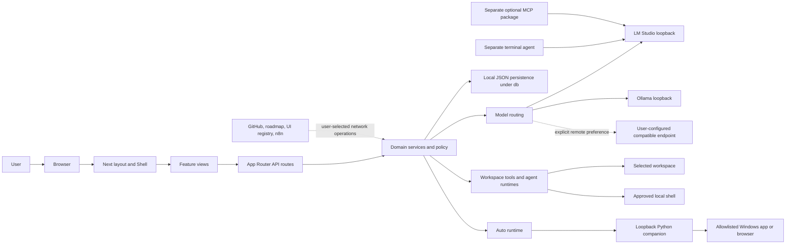

# 01 — Complete system architecture

## Architecture in layers

1. **Presentation** — `src/app/layout.tsx` installs global CSS, font metadata,
   theme and toast providers; `src/app/page.tsx` renders `Shell`; feature views
   live in `src/components/agent-hub/`.
2. **HTTP boundary** — App Router handlers under `src/app/api/` parse and
   validate input, apply origin/session policy where implemented, and return
   JSON, SSE, or errors.
3. **Domain services** — `src/lib/agent-hub/` contains model routing, agent
   runtimes, tool policy, workspace services, persistence, roadmaps, skills and
   Auto coordination.
4. **Execution adapters** — fetch-based compatible model transport, shell and
   file tools, Python UI Automation companion, optional MCP/terminal processes.
5. **Persistence** — JSON files under `db/`, plus browser localStorage for
   presentation preferences. This is single-process file storage, not a
   concurrent multi-instance database deployment.

## Diagram 1 — high-level system

The bottom two processes are repository siblings rather than children of the
Next.js request tree. `npm start` starts the web application; it does not imply
that a terminal agent or MCP server is running.

## Architectural decisions and limits

- **Separate loops:** general Chat (`src/app/api/chat/route.ts`), Sessions
  (`src/lib/agent-hub/session/runtime.ts` and adjacent modules), and the broader
  `agent-session.ts` feature runtime have different tool contracts and state.
- **HTTP adapter, local runtime:** model calls use an OpenAI-compatible wire
  format. Protocol compatibility is not a hosted-provider connection; providers
  are endpoint configurations. The default registry is local.
- **Service modules own persistence:** routes are adapters, not storage owners.
  `chat-store.ts`, `state-file.ts`, `playground-store.ts`, session services and
  `db-path.ts` define durable behavior.
- **Single process:** serializers protect selected read/modify/write sequences
  inside one server process. They do not coordinate multiple server instances.
- **Application policy:** route checks and confirmation gates do not become
  operating-system sandboxing. Windows programs and approved shells run under
  the logged-in account.

## Repository evidence

The current architecture guide is `docs/architecture.md`; developer operation
is `docs/development.md`; tests and their limits are `docs/testing.md`. Routes
are enumerated in `src/app/api/`. The current shell navigation and view mapping
are in `src/components/agent-hub/shell.tsx`.
