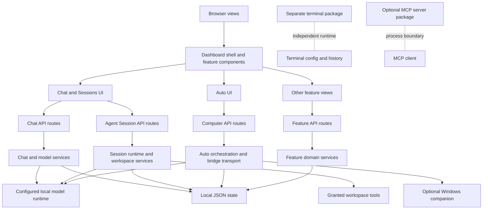

# 03 — Repository structure

## Top-level map

```text
src/app/                    Next App Router pages, layouts and API routes
src/components/agent-hub/   Dashboard shell and feature interfaces
src/components/ui/          Reusable presentational primitives
src/lib/agent-hub/           Domain, runtime, validation, tools and persistence
src/lib/agent-hub/session/   Current coding-session loop and workspace services
src/lib/agent-hub/computer/  Auto orchestration and Python bridge protocol
agenthub-computer/           Optional Windows UI Automation companion
AgentHub-CLI/           Separate Node terminal agent and test suite
lmstudio-local-agent/        Separate Python MCP server and sample projects
agenthub-vm/                 VM preparation notes/tooling; not a verified sandbox
scripts/                     Startup/build, source audits and regression suites
db/                          Local JSON state and user-created data (preserve)
public/                      Served AgentHub assets and inert n8n sample templates
docs/                        Current operations docs and history
.verification/               Test/build evidence and logs, generated locally
```

This is a responsibility map, not a literal exhaustive file listing. For
individual source inventory and review decisions use `docs/repository-audit.csv`;
that CSV is generated source metadata and can become stale after edits.

## Important entry points

| File/directory | Responsibility / caller relationship |
|---|---|
| `src/app/layout.tsx` | Root metadata, fonts, global stylesheet, theme and toast providers. |
| `src/app/page.tsx` | Client entry: returns `Shell`. |
| `src/components/agent-hub/shell.tsx` | Navigation, keyboard shortcuts, profiles and conditional feature mounting. |
| `src/app/api/chat/route.ts` | Chat history/status and request handling, model resolution, tool/quiz behavior, streaming response. |
| `src/lib/agent-hub/llm.ts` | Shared local provider discovery, compatible inference transport and token usage extraction. |
| `src/lib/agent-hub/session/` | Current Sessions state, model loop, tools, approvals and workspace grants. |
| `src/lib/agent-hub/agent-session.ts` | Large older runtime used by Tasks and teaching/design paths; not the same loop as current Sessions. |
| `src/lib/agent-hub/computer/` | Auto task lifecycle, permission state, bridge requests and transport contract. |
| `agenthub-computer/controller.py` | Native Windows app/window inspection and approved input actions. |
| `src/lib/agent-hub/db-path.ts` | Durable database directory selection, separate from active workspace root. |

## Configuration and generated outputs

`package.json` and `package-lock.json` define the active npm workflow; `bun.lock`
belongs to optional deployment scripts and is documented as stale/unverified in
`docs/development.md`. `next.config.ts`, `tsconfig.json`, `eslint.config.mjs`,
`scripts/start-local.mjs` and `scripts/build.mjs` define app operation. The
Next-generated `AGENTS.md` rules in this checkout require local version docs
before changing Next code. `.next*`, `node_modules`, `db`, and `.verification`
are not source modules.

## Module relationship rules

Client views call API routes, not filesystem services directly. Server routes
delegate to domain services. Model settings are configuration, not permissions:
the model selector does not grant workspace, shell or computer capabilities.
Routes and services retain separate validation layers. The detailed module
dependencies are shown in [chapter 1](01-COMPLETE-SYSTEM-ARCHITECTURE.md) and
[chapter 5](05-BACKEND-ARCHITECTURE.md).

The repository includes more than the main dashboard: terminal and MCP packages
are independent products with their own manifests, tests, policies and state.
Claims about their features must name those packages rather than attributing
them to the web application.

## Diagram 8 — dependency and module relationships



### Coupling observations

- The browser feature components are a broad dashboard surface, but requests
  pass through route boundaries before reaching server-only filesystem or
  desktop capabilities.
- The legacy `agent-session.ts` remains a large multi-purpose runtime. Current
  coding Sessions use the newer `session/` directory; treating those as one
  subsystem would hide duplicated orchestration responsibilities.
- Multiple features persist local JSON records through shared path/storage
  helpers. This keeps the installation simple but makes schema ownership and
  concurrent writes important review points.
- The terminal agent and optional MCP server are adjacent repository products,
  not runtime dependencies of the dashboard. Their dependency arrows are
  intentionally dashed to show their separate process boundaries.
