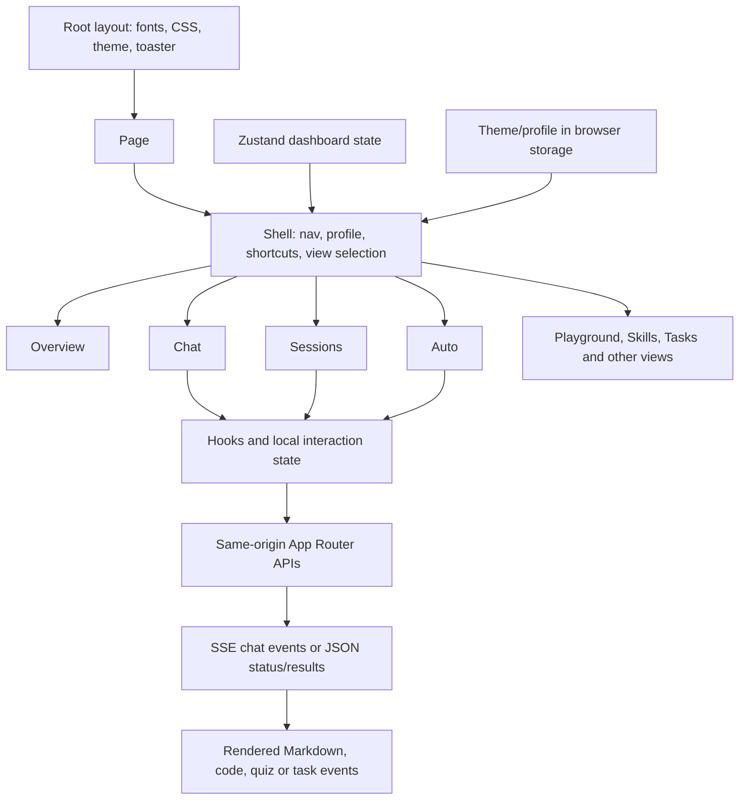

# 04 — Frontend architecture

## Page and component tree

`src/app/layout.tsx` wraps the document in `ThemeProvider` and mounts the
application toast host. `src/app/page.tsx` renders the client shell. In
`src/components/agent-hub/shell.tsx`, a `ViewId` navigation list chooses a
feature component: Overview, Chat, Agents, Sessions, Auto, Tasks, Changes,
Playground, UI Components, Models, Settings, or Agent API. Design Studio also
has its own route. The shell owns navigation/profile state and passes selected
local-profile presentation options to Chat, Sessions and Auto.

Shared dashboard state is in `src/lib/agent-hub/store.ts` and feature hooks.
Chat history is fetched from the chat APIs; active request state is separate in
`chat-runs.ts` so view unmounts do not necessarily cancel an in-page stream.
Sessions has local presentation state and fetches its server-backed conversation
list. Auto polls the computer task snapshot and dispatches explicit action
requests. Local preferences such as theme/profile presentation can live in
localStorage; durable domain records use server-side storage.

## Diagram 2 — frontend architecture

## Request and response handling

Buttons, forms, keyboard shortcuts and conversation controls trigger handlers
inside client components. They send same-origin `fetch` requests, usually JSON.
Chat can consume `text/event-stream`; its parser/store merges incremental events
into a stable conversation and handles cancellation/partial results. Other pages
poll or reload structured JSON. Errors should surface route failures, not
pretend success; whether a control is live is defined by its handler and tests,
not inferred from its appearance.

## Layout and interaction patterns

The global CSS defines light/dark tokens and typography; feature modules use
utility classes and CSS Modules for complex surfaces. Responsive layout is
implemented by shell and view breakpoints. Sidebar navigation supports the
`g` then number shortcut only when focus is not in an editable field. Profile
menus expose selected view shortcuts. Chat and Sessions keep conversation lists
distinct from message presentation. See [chapter 12](12-UI-UX-ARCHITECTURE.md)
for spacing, colors, keyboard behavior and accessibility limits.

## State boundaries

- **Ephemeral UI state:** open menus, draft input, active tab and pending flags.
- **Shared browser state:** dashboard store and subscriptions to chat-run snapshots.
- **Server state:** conversation records, workspace grants, tasks and usage state.
- **Persisted preference:** profile/theme/model configuration at their documented
  browser or JSON locations.

Avoid moving API credentials or filesystem paths into client state. API
responses serialize custom-model records without returning secret keys.
