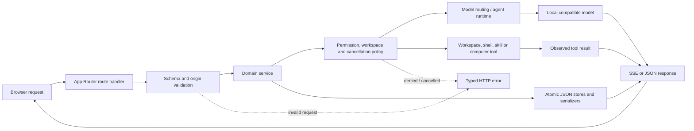

# 05 — Backend architecture

## Request boundary

The backend is the same local Next.js process as the frontend, not a separate
microservice fleet. `src/app/api/**/route.ts` handlers implement HTTP methods,
parse and validate input, enforce route-specific origin/session/permission
rules, and delegate to `src/lib/agent-hub/**`. Next.js App Router handlers use
Web Request/Response primitives and are not page components.

## Diagram 3 — backend layers

## Service ownership

Chat routes call `chat-store.ts`, `chat-runs.ts`, `model-routing.ts`, and the
shared LLM transport. Current coding Sessions split responsibilities among
`session/store.ts`, `session/runtime.ts`, `session/model.ts`, `session/tools.ts`,
`session/runner.ts`, `session/paths.ts`, and `session/workspaces.ts`. Auto has
`computer/runtime.ts`, `computer/protocol.ts`, and `computer/bridge.ts`.
Workspace file and shell capabilities are shared through `workspace-files.ts`
and `workspace-exec.ts`. The older `agent-session.ts` still owns teaching and
several task/design paths; its size is an acknowledged maintenance cost.

## Errors, cancellation and data access

Request schemas return clear client errors for malformed bodies. Model/provider
errors are sanitized; provider bodies are untrusted and are not returned
directly. Chat cancellation aborts upstream work and closes its stream; session
and Auto provide explicit stop controls. Persistence uses atomic writes and
targeted serializers, but this is not transactional multi-process storage. Route
success does not prove model inference or a Windows action occurred.

## Trust and server-only code

Filesystem, process and Windows integrations stay on the server or in local
companions. Client components call API routes instead of importing those
modules. `scripts/audit-repository.mjs` contains a dependency-graph check for
client-to-server native imports. API origin checks are host-based protections,
not user authentication; the app is designed for local access, not direct public
hosting.

## Main route families

`/api/chat` and `/api/chat/conversations`; `/api/agent-session/conversations`,
`files`, `exec`, `models`, `workspaces`; `/api/computer`; `/api/runtime/models`;
`/api/custom-models` and `/api/model-preference`; `/api/playground`; `/api/skills`;
`/api/n8n` and `/api/n8n-templates/[id]`; `/api/ui-components`; `/api/usage`;
`/api/system-metrics`; `/api/explain`; `/api/agent`. Each has different
validation and side effects; inspect its route before treating it as equivalent
to another API.
