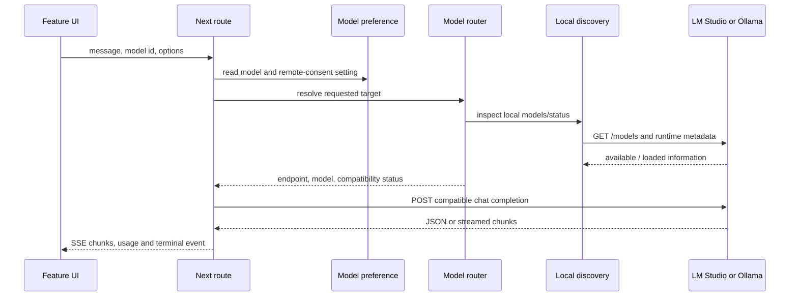
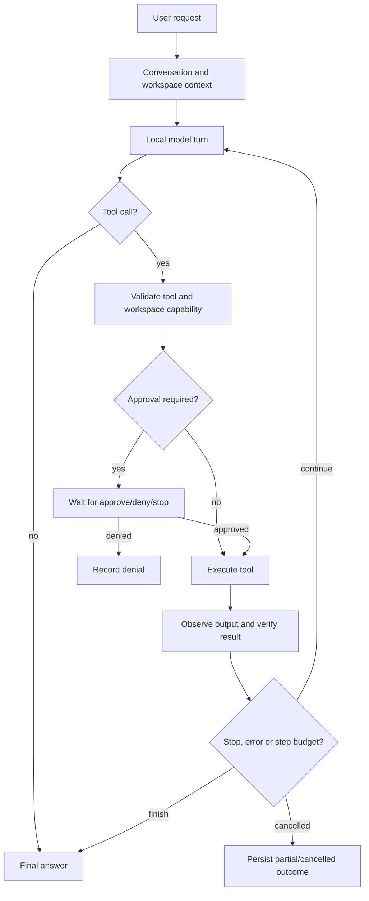

# 06 — Local AI and agent architecture

## Diagram 4 — model request path

Local discovery uses fixed providers in `chat-settings.ts`: LM Studio on
loopback port 1234 and Ollama on 11434. `llm.ts` checks inventory and loaded
state where supported; it does not invent a loaded model. `model-routing.ts`
chooses the local default and blocks remote endpoints unless the shared
preference explicitly permits them. Auto uses a stricter local-only policy.
Actual availability depends on the separate local server and loaded model. The
OpenAI-compatible path is a protocol, not a hosted service.

## Diagram 5 — Sessions agent loop

The current coding runtime supports multiple model/tool iterations, a bounded
step budget, cancellation and result observation. It is not evidence of
guaranteed reflection or code repair. Workspace tools are application-level
guarded; commands run as the user. Session memory is conversation/context
history, not a separate vector database.

## Distinct model consumers

General Chat sends conversational context and can stream. Current Sessions build
coding context and select tools from their registry. The older
`agent-session.ts` handles teaching/task/design features with its own prompts
and procedures. Auto interprets observed desktop state and asks approval for
input. Terminal has its own provider client and permission broker. These
consumers may share settings or a compatible protocol, but do not share one
universal planner.

## Selection and recovery

An explicitly selected model must resolve; an unavailable model should fail
visibly rather than silently switch to an unrelated remote service. A request
can fail due to an offline server, unloaded model, tool-call incompatibility,
context limits, timeout, malformed stream or cancellation. Errors are sanitized.
Retries after partial output are constrained to avoid duplicating side effects.
`check-runtime-models` covers inventory/loaded-state assertions;
`check-live-local-models` is an opt-in real inference check.
