# 07 — Complete workflow flowcharts

These diagrams describe implementation paths at a useful level; they omit
framework internals. Exact schemas and side effects are in the linked routes and
domain services.

## 1. Application startup

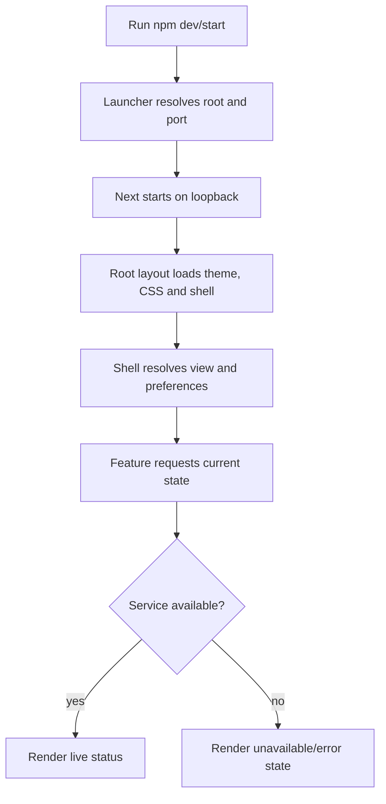

## 2. Navigation

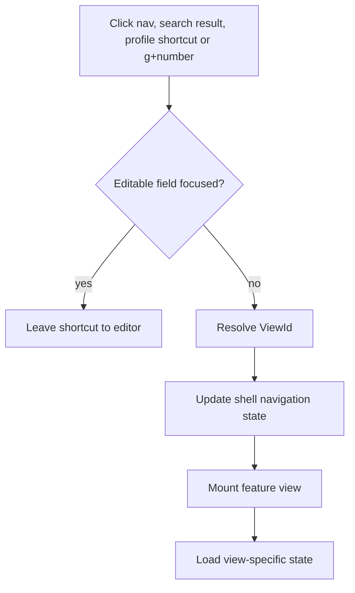

## 3. Local model discovery and selection

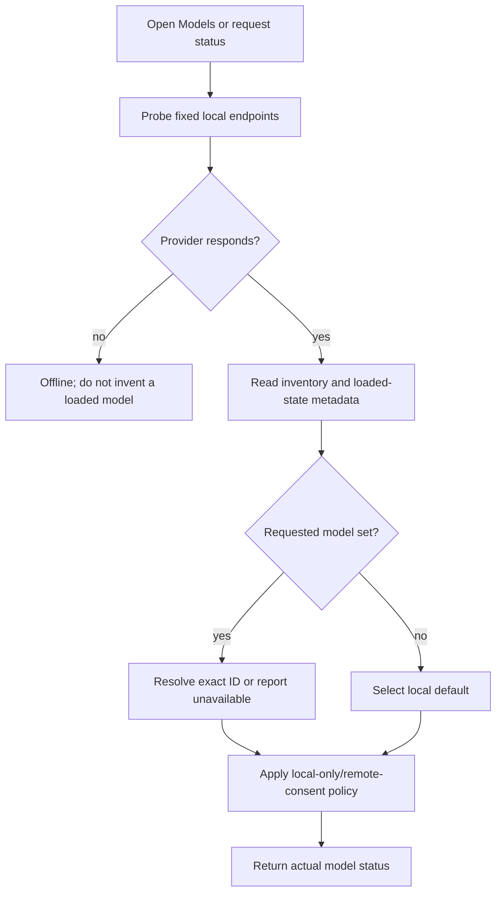

## 4. Chat send and receive

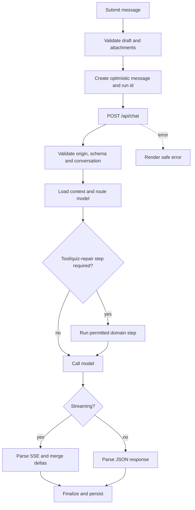

## 5. Agent task execution (Sessions)

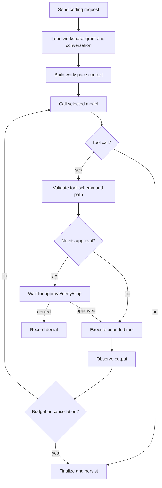

## 6. Terminal command execution

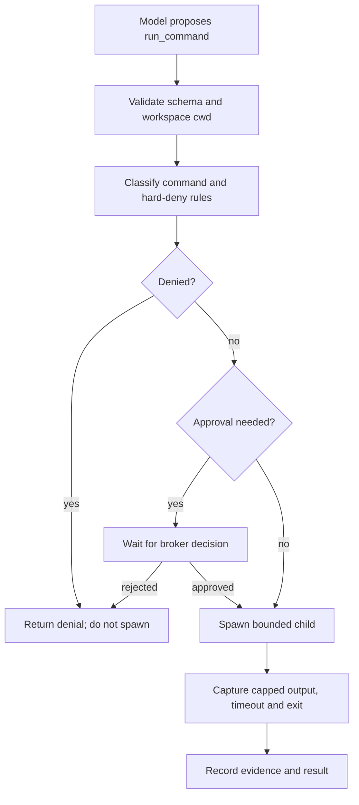

## 7. Workspace file operation

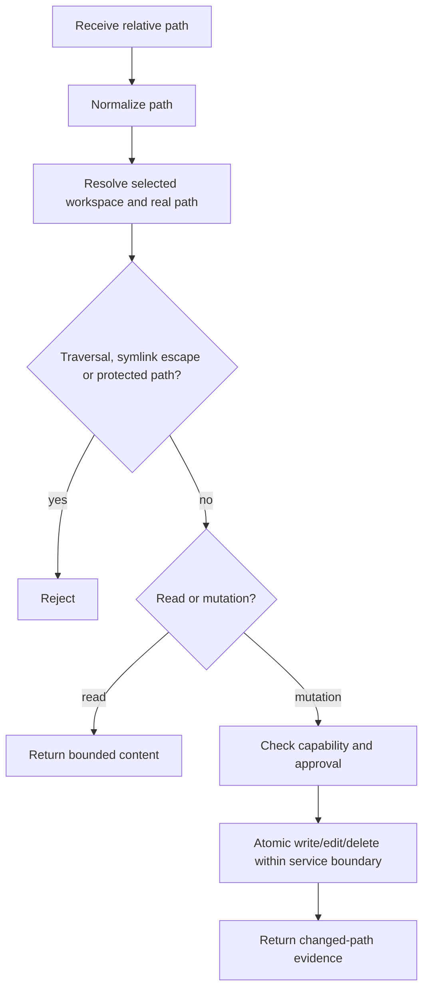

## 8. Skills installation and invocation

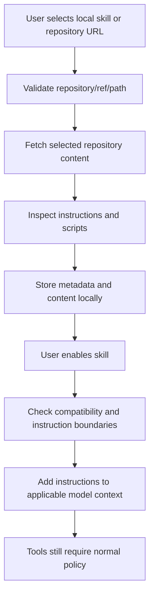

## 9. Slash command

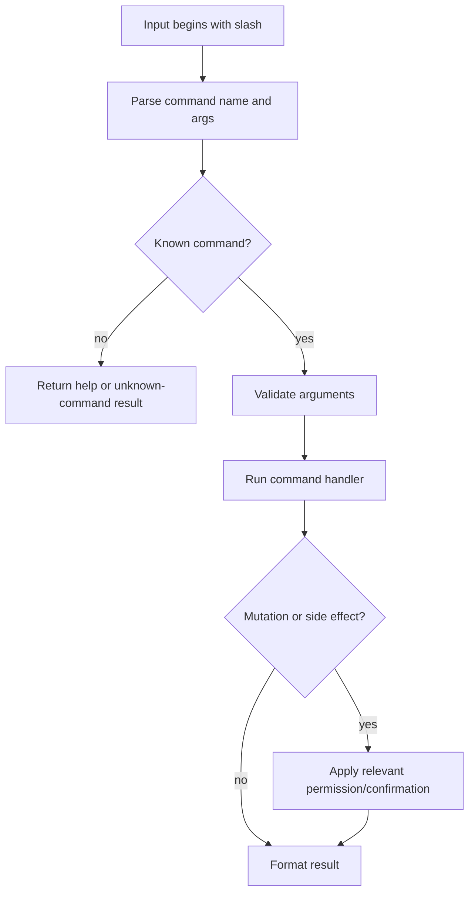

## 10. Session creation and persistence

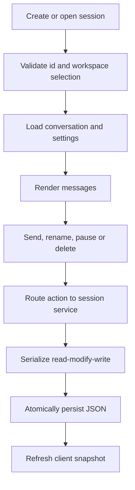

## 11. Roadmap and teaching

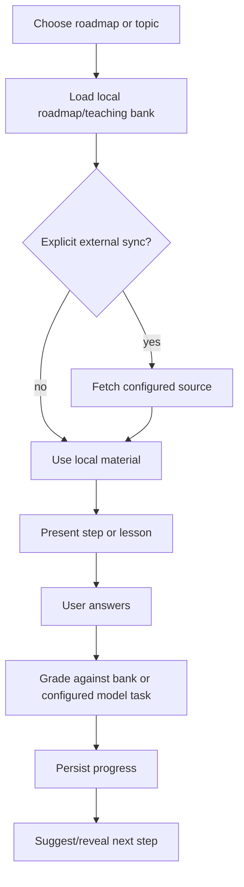

## 12. Playground

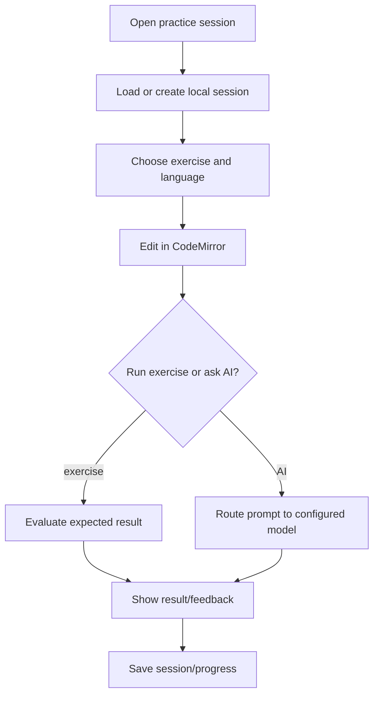

## 13. Windows automation

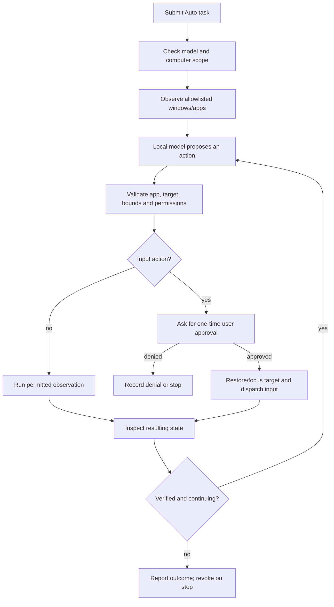

## 14. Failure, cancellation and recovery

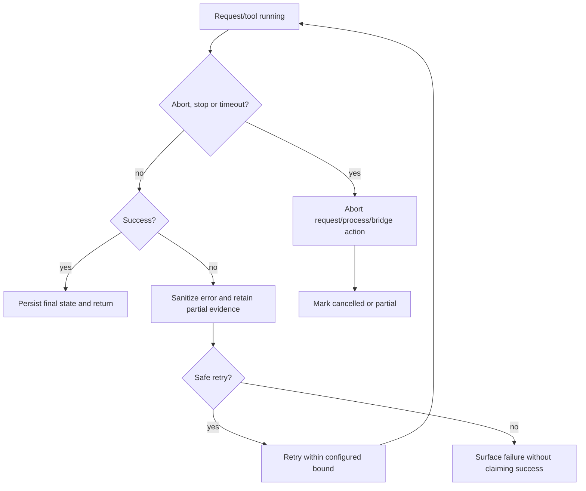

The charts are conceptual summaries. Exact action schemas, approval IDs and
retry behavior belong to the referenced route/service files and companion
protocol; read those before adding a tool.
