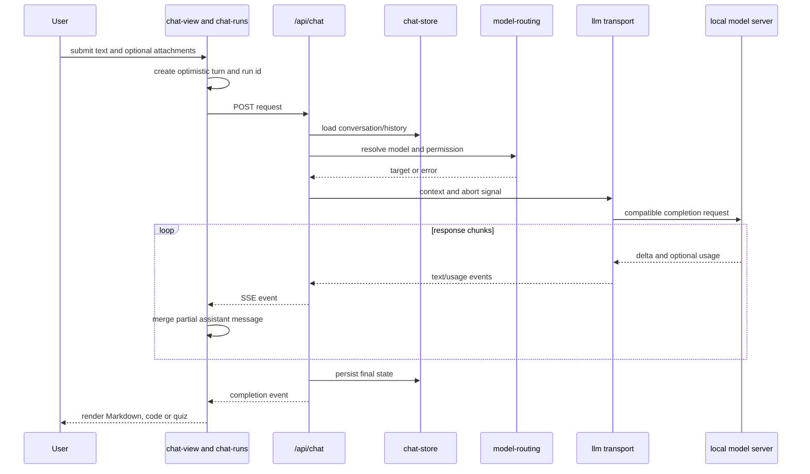
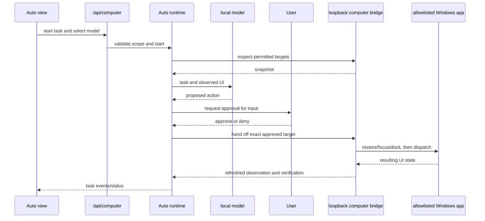
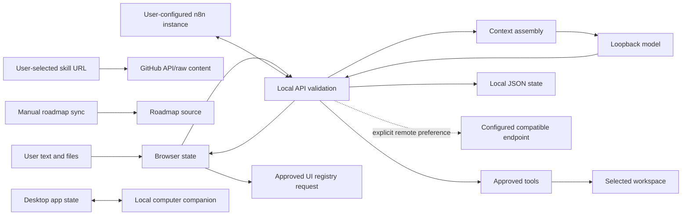

# 08 — Sequence and data-flow diagrams

## Chat sequence: streamed response



The route can branch for attachments, teach mode, quiz repair and coding-agent
settings. Cancellation aborts upstream work. If a stream ends after partial
output, the UI retains partial state and should not present it as verified.

## Sessions tool sequence

```mermaid
sequenceDiagram
  participant User
  participant View as session-chat-view
  participant API as session conversation route
  participant Loop as session runtime and runner
  participant Model as configured local model
  participant Broker as approval broker
  participant Tool as workspace tool
  participant Disk as workspace and JSON store
  User->>View: send task
  View->>API: send action with conversation id
  API->>Loop: load state and start turn
  Loop->>Disk: read conversation/workspace metadata
  Loop->>Model: context and tool schemas
  Model-->>Loop: answer or tool request
  opt Approval required
    Loop->>Broker: publish exact proposed action
    Broker-->>View: approval event
    User->>View: approve or deny
    View->>API: decision
    API->>Broker: resolve decision
  end
  Loop->>Tool: execute validated action
  Tool->>Disk: bounded read/write/command
  Disk-->>Tool: output/evidence
  Tool-->>Loop: observed result
  Loop->>Model: follow-up with tool result
  Loop->>Disk: persist transcript/state
  Loop-->>View: events and final result
```

## Auto sequence



## Data flow and trust boundaries



The user, browser, local server, model runtime, model-produced tool proposal and
workspace files are separate trust domains. Model and tool output are untrusted.
A selected folder narrows workspace services; it does not restrict every native
process at the OS level. The separate independence audit lists the external
network paths and which require user action.

## Request and event shapes

General Chat accepts JSON carrying a message, optional settings and
attachments; responses can be JSON or SSE. Current Sessions sends an action
(`create`, `send`, `approve`, `stop`, etc.) with a conversation ID; the server
owns the execution loop. Auto requests include task/model/profile and record
approval events. Exact schemas reside in route files and shared validators;
these diagrams are not API contracts.
