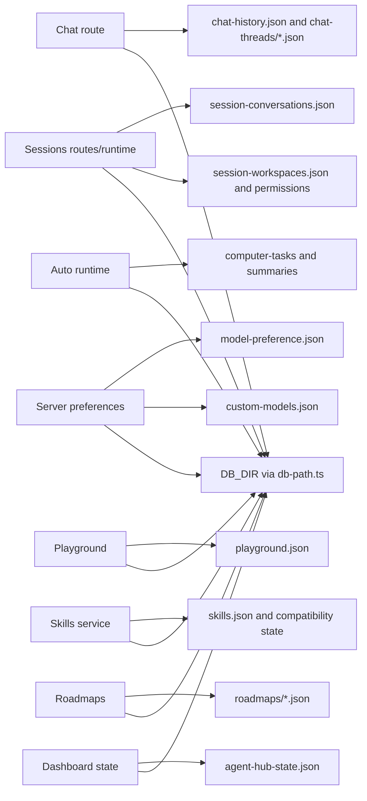

# 10 — Data storage and memory

## Diagram 7 — storage architecture

## Formats and relationships

The primary web-app persistence is local JSON under the selected `DB_DIR`,
resolved by `db-path.ts`. Conversations link by IDs, not relational foreign-key
enforcement. Chat legacy history and named chat threads are distinct stores.
Sessions record conversations and workspace references; computer-task history
has separate task and summary files. Playground, roadmap, custom-model, skills,
settings, and usage records each have domain-specific serializers. Prisma is an
optional schema/CLI contract, not the active application store.

The terminal agent uses its own `~/.agenthub`-style config/session/memory
directories. The optional Python MCP package has project-local ledger/config
state. Browser localStorage contains UI preferences and should not be confused
with server-side conversation records.

## Atomicity, concurrency and data loss

`fs-atomic.ts` provides atomic replacement helpers; selected stores serialize
read/modify/write operations within one Node process. This protects against
partial files and in-process races, not competing servers writing the same
directory. Backups/quarantine behavior is feature-specific. Existing `db/`
contains user data: audit and migration must preserve it, and schema changes
should be additive or backed up.

## Memory and context are different

An agent's prompt context may combine current request, recent turns, project
instructions, tool summaries, skills, and prior notes. Context budgets truncate
or summarize; persisted logs survive requests; usage events measure activity.
The terminal package has explicit local memory commands. The browser app does
not use one global semantic/vector memory service. Treat content loaded from
workspace files, skills and model output as untrusted.

## Retention questions for production

The current design is suitable for a single local user and modest local records.
For multi-user or multi-process deployment, add authenticated identity, access
control, transactional DB semantics, retention/deletion policy, encryption
design and migration versioning. This is a design recommendation, not a claim
those facilities exist now.
