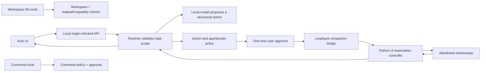

# 11 — Tools, skills and Windows automation

## Diagram 6 — Windows automation boundary

## Tool calling

Tools convert an LLM proposal into a validated operation. The safe sequence is:
parse schema; authorize capability; validate the path/target; get approval if
required; execute with limits; observe output; verify a meaningful postcondition;
record evidence. A model's assertion that a tool succeeded is not itself proof.
Sessions tools are in `session/tools.ts`; workspace services are
`workspace-files.ts` and `workspace-exec.ts`; terminal tools live in
`AgentHub-CLI/src/tools/` with a separate policy engine.

## Skills

Skills are user-provided instructions plus metadata and optional references.
GitHub import uses API/raw endpoints only after the user selects a repository.
Compatibility inspection can flag provider-specific instructions; scripts are
not automatically run. Enabling a skill changes prompt context, not permission
grants. Prompt injection remains possible if untrusted instructions are treated
as policy; runtime authorization must stay outside the model.

## Windows control procedure

Auto uses `/api/computer` and `src/lib/agent-hub/computer/` to manage scope,
task events, approvals, cancellation and the local companion. `controller.py`
uses Windows UI Automation/Win32 to inspect windows, controls and app state,
then dispatches focus, click, typing, scroll or related actions allowed by its
contract. It can capture observations/screenshots when configured. The approval
handoff restores the same verified window, docks it to the right half, refreshes
its snapshot and checks the target before dispatch. A re-used/restarted window
handle or changed target must fail safely.

## Security boundary

The app can constrain its own file and UI action contracts. It does not isolate
Notepad, a browser, a terminal or other desktop programs from the rest of the
Windows account. A folder selection does not confine arbitrary native app writes.
Input is approved per action; permission scope and allowlists are revocable.
VM tooling is not evidence of an active sandbox. Do not describe this as
OS-level containment.

## Terminal and MCP are separate

`AgentHub-CLI/` is a separate Node agent with workspace, shell, file,
approval and optional MCP tools. `lmstudio-local-agent/` exposes a separate MCP
server and fixed project-oriented actions. They need their own launch/config and
have different state. The web dashboard does not automatically invoke them.
