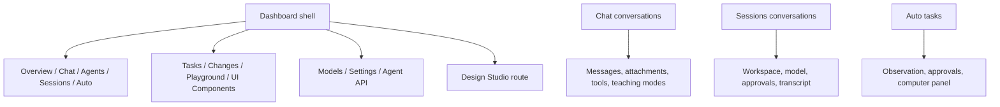

# 12 — UI/UX architecture

## Navigation map

## Design system

`src/app/globals.css` defines global colors, border/radius, typography and
surface variables for light and dark themes. `next-themes` applies the selected
theme class, while `ThemeProvider` can follow system preference. Tailwind
utilities build most layouts; component CSS Modules handle network graphs,
profile/conversation appearance, Auto, and marketplace views. Geist sans and
monospace fonts are configured in root layout. Lucide icons and shared Radix
primitives establish common control behavior.

Exact token values change with source; consult `globals.css` before quoting
colors or sizing. The interface uses soft surfaces and rounded panels in many
views, with more specialized, dense work areas for Sessions, Auto and
Playground. This chapter records structure, not a redesign proposal.

## Interaction patterns

- Sidebar selection changes `ViewId`; browser query parameters can represent a
  deep-linked view/conversation.
- Chat shows a conversation list/header, model status, teaching/settings
  controls, message body and composer. Keyboard shortcuts should not steal focus
  from text inputs.
- Sessions separates conversation/workspace context, model/permission state,
  events, approvals and composer.
- Auto includes task history, visible execution status, scope and computer
  observation panes. Each computer input requires approval under its scope.
- Models displays live local inventory separately from user-configured endpoints.
- Loading, empty and error conditions are generally page-specific; do not infer
  one global success state from a shared badge.

## Accessibility and responsive behavior

Buttons use labels/tooltips and Radix primitives where present. The front end
uses semantic buttons/forms and focus-aware shortcuts; however this documentation
does not claim a full WCAG audit. Verify keyboard navigation, contrast, focus
restoration, screen-reader announcements and narrow viewport behavior with a
browser/accessibility test. Some dense tables and multi-pane layouts need special
small-screen review.

## Functional controls

`src/components/agent-hub/shell.tsx` defines available navigation targets.
Feature components define whether each control submits a real route request or
only changes local presentation. Regression suites cover structural UI and
several interactions, but a screenshot is not proof of functionality. See the
test report and actual event handlers for the controls used in a workflow.
