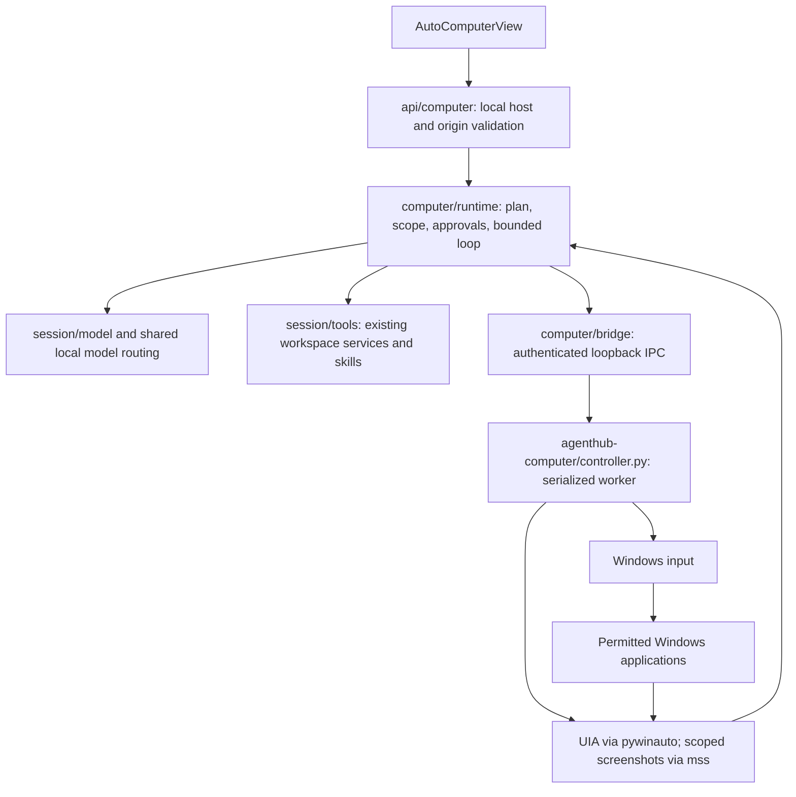

# Windows computer control — architecture audit

Audit checkpoint: 2026-10-28, before the visible-input implementation. This is an
audit of the relevant execution paths, not a claim that all application files or
Windows configurations have been tested.

## Existing execution paths

Sessions already use `session/agents.ts` for `/website`, `/game`, `/research`,
and `/other`; `parseSessionAgentRequest` selects the registered instructions.
`session/runner.ts` consumes injected model, approval and executor functions.
`session/tools.ts` delegates filesystem and command operations to
`workspace-files.ts` and `workspace-exec.ts` and reads validated installed skills
from `skills-registry.ts`. Workspace registration and access are separate from
native desktop authorization. No additional model provider or skills registry is
needed.

Auto already has a bounded observation/tool loop, approval UI, task events,
pause/resume/stop, local-model discovery, a compatible-vision check and compact
transcripts. It reuses the Session model responder, transcript compaction and
workspace tool executor. It does not yet route slash commands through the shared
agent registry. Its existing specialized loop is the integration point; a second
computer runtime would duplicate these responsibilities.

The Python companion already runs in the logged-in Windows session. It binds an
ephemeral loopback port, requires a random bearer token provided by its parent,
rejects browser-origin requests, watches the parent process, serializes operations
on a COM-initialized worker and registers Ctrl+Alt+Shift+Escape. UIA snapshots
have bounded trees and expiration; targets are checked against the permitted
process, window bounds, visibility, enabled state and protected controls.

## Confirmed gaps at audit time

- `desktop.click` can call `control.invoke()` and even skip the foreground check.
  That does not satisfy real visible pointer control.
- Mouse and key operations do not share cancellation-safe input ownership.
  Stop does not explicitly release all injected held input; queued start requests
  can survive a stop unless their authorization generation is invalidated.
- Mouse position, hover, explicit down/up, window state operations, Calculator,
  Office discovery, pointer-duration settings and screenshot disabling are absent.
- Only per-action approval exists. A task-scoped approved-apps mode needs a
  conservative high-risk action policy, not a text prompt that grants itself power.
- Auto has no registered-agent identity or slash routing.
- Existing result verification often checks only that expected text exists, not
  that the action produced the expected state. Native dispatch must stay separate
  from verified task success.
- Browser tools use Playwright and must be labelled programmatic browser control;
  their clicks are not evidence of operating-system pointer movement.
- Existing test artifacts are historical evidence only. The requested live tests,
  UI screenshots and display-configuration matrix still require fresh validation.

## Technology choice

Keep pywinauto/UIA for observations, Win32 for window state, and the existing
authenticated Python companion. Add a small native-input module using
`GetCursorPos`, `SetCursorPos` and `SendInput`, with explicit held-input ownership,
per-action checks and safe release. Retain the PyAutoGUI fail-safe. This adds no
automation framework or second process runtime.

UIA is suited to inspecting controls across Windows frameworks; InvokePattern
can activate controls without moving the cursor. Microsoft's winappCli offers
UIA and mouse simulation but would add a parallel companion here. PyAutoGUI is
already installed, but its documentation describes primary-monitor limitations;
native signed screen coordinates avoid making it the multi-monitor coordinate
authority. Playwright remains useful for DOM inspection and its explicitly
programmatic browser mode, not evidence of visible Windows input.

Primary references reviewed:

- [UI Automation](https://learn.microsoft.com/en-us/windows/win32/winauto/uiauto-uiautomationoverview)
- [winappCli UI automation](https://learn.microsoft.com/en-us/windows/apps/dev-tools/winapp-cli/ui-automation)
- [pywinauto](https://github.com/pywinauto/pywinauto)
- [SendInput and integrity restrictions](https://learn.microsoft.com/en-us/windows/win32/api/winuser/nf-winuser-sendinput)
- [SetCursorPos](https://learn.microsoft.com/en-us/windows/win32/api/winuser/nf-winuser-setcursorpos)
- [PyAutoGUI documentation](https://pyautogui.readthedocs.io/en/latest/)
- [Playwright input](https://playwright.dev/docs/input)

`SendInput` is subject to Windows integrity restrictions. No elevation, secure
desktop switching or UAC bypass will be added. An input return value confirms
dispatch only; UIA/readback and application state must verify the result.

## Outstanding acceptance work

The requested 20 acceptance criteria are not yet satisfied. Implementation and
fresh real-app evidence are required for visible input, all mouse/key operations,
window state, safe interruption, agent routing, scoped automatic approvals,
model-driven multi-step tasks and the five required technical documents. Browser
automation in the Codex host is disabled; that blocks host-driven UI screenshots
but does not establish a defect in AgentHub or justify bypassing host settings.
