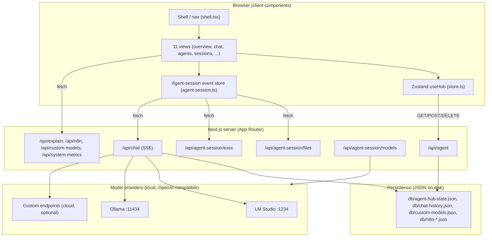
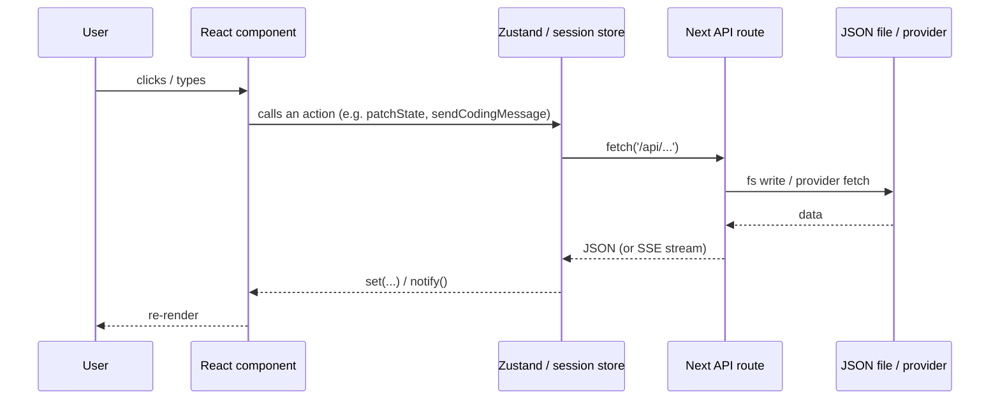
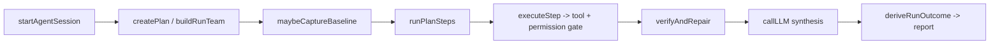
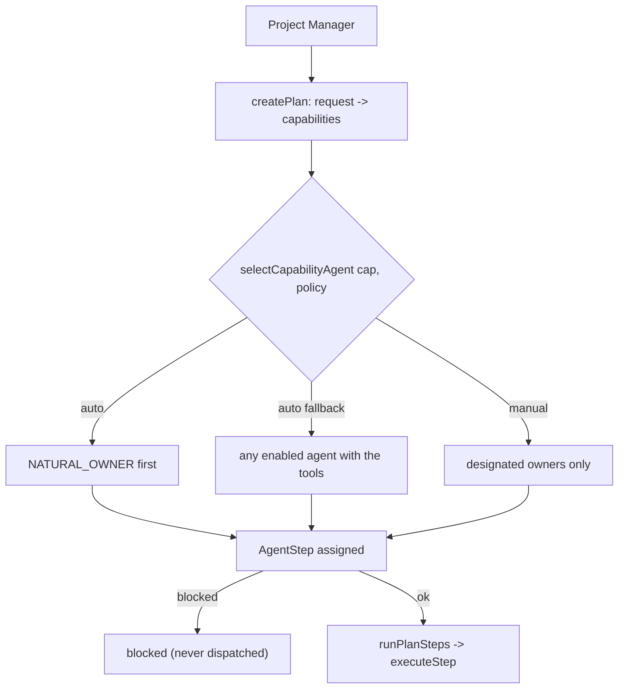
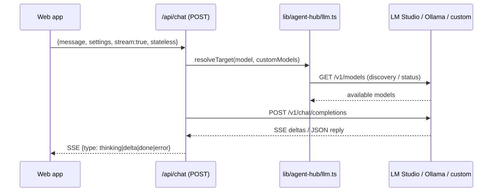
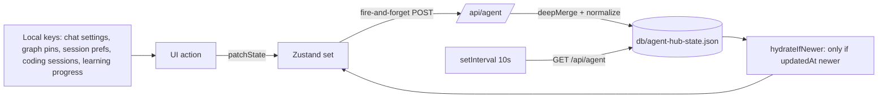
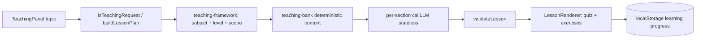
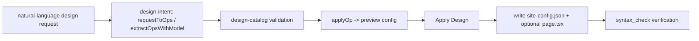

> Historical evidence. This file describes an earlier implementation; use [current architecture](../architecture.md), [development](../development.md) and [testing](../testing.md) for the current project.

# AgentHub — Complete Project Walkthrough & Architecture Audit

> **Purpose of this document.** A single, evidence-based guide to the AgentHub
> project as it exists in this workspace *right now*. It is written so a new
> developer can understand, run, debug and extend the project without relying on
> previous chat history or reports.
>
> **How it was produced.** A primarily **read-only** investigation of the actual
> source tree, API routes, configuration and persistence, plus safe verification
> scripts executed in this session. The only file created is this document.
> No application source was modified.
>
> **Honesty rules used throughout.**
> - **Verified by code** — implementation is present and behaviour follows from
>   inspection (file + function + line cited).
> - **Runtime verified** — the behaviour was exercised successfully (script
>   output or a running app recorded).
> - **Partially implemented** — some required behaviour exists, the rest is missing.
> - **Not implemented** — absent.
> - **Not verified** — evidence is insufficient to confirm runtime behaviour.
> - Code existence is **not** treated as proof of correct runtime behaviour.
> - No secrets, API keys or tokens are reproduced anywhere in this document.

---

## Table of contents

1. [Executive summary](#1-executive-summary)
2. [What AgentHub is (plain language)](#2-what-agenthub-is-plain-language)
3. [Architecture](#3-architecture)
4. [Technology stack](#4-technology-stack)
5. [Directory and file map](#5-directory-and-file-map)
6. [Startup procedure](#6-startup-procedure)
7. [Frontend and navigation walkthrough](#7-frontend-and-navigation-walkthrough)
8. [Backend and API inventory](#8-backend-and-api-inventory)
9. [State management and persistence](#9-state-management-and-persistence)
10. [Agent system architecture](#10-agent-system-architecture)
11. [Sessions execution lifecycle](#11-sessions-execution-lifecycle)
12. [Tool execution and safety](#12-tool-execution-and-safety)
13. [Local-model integration](#13-local-model-integration)
14. [Chat rendering](#14-chat-rendering)
15. [Teaching Agent status](#15-teaching-agent-status)
16. [UI/UX Design Agent and template library](#16-uiux-design-agent-and-template-library)
17. [Remaining feature walkthrough](#17-remaining-feature-walkthrough)
18. [Real user workflows](#18-real-user-workflows)
19. [Testing and runtime verification results](#19-testing-and-runtime-verification-results)
20. [Feature completeness matrix](#20-feature-completeness-matrix)
21. [Risks, bugs and missing features](#21-risks-bugs-and-missing-features)
22. [Extension and maintenance guide](#22-extension-and-maintenance-guide)
23. [Glossary](#23-glossary)
24. [Ordered learning path](#24-ordered-learning-path)

---

## 1. Executive summary

AgentHub is a **local-first AI agent control center** built on **Next.js 16
(App Router) + React 19 + TypeScript + Tailwind v4 + shadcn/ui**. It runs as a
single Next.js application: a browser dashboard (11 views) plus a small set of
server API routes.

The project has **three genuinely different "agent" concepts**, which is the
single most important thing to understand:

1. **The dashboard data model** (`HubState`) — seeded demo data for agents,
   sessions, models, a code graph, a plan, git-changes and a workflow, shown in
   most views. It is a *presentation* model persisted as JSON at
   `db/agent-hub-state.json` and updateable by an external "laptop agent"
   through `POST /api/agent`.
2. **The Agent Session runtime** (`src/lib/agent-hub/agent-session.ts`, ~4,170
   lines) — the real executor. A Project Manager decomposes a request,
   capability-matches it to specialists (**AUTO/MANUAL**), runs steps through a
   validated tool registry, gates consequential actions behind human approval, and
   produces an evidence-based report. Its UI is the **Sessions** view.
3. **Two app-owned specialist pipelines** layered on the same runtime —
   the **Teaching Agent** and the **UI/UX Design Studio** — where the *app* owns
   the structure/validation and the local model only enriches content.

**What genuinely works today (runtime verified this session):**
- The Agent Session runtime and its 365-case regression suite (**365 passed, 0 failed**).
- Six further self-contained verification suites (**127 checks passed** collectively).
- TypeScript compiles with only **2 pre-existing errors** in `examples/websocket/*`.
- Chat streaming, teaching lessons, design apply, model discovery and the
  Agent API are all implemented and exercised.

**What is incomplete / risky (details in §21):**
- Prisma is declared but **not used** for persistence (all persistence is JSON files).
- **No authentication, no rate limiting** on any API route; the only CSRF control
  is a same-origin check (and it is missing on `custom-models` and several GETs).
- Custom models are stored in **two places** that can diverge.
- The whole thing is **not a git repository**, so there is no VCS history/safety net.
- Several views (Changes, Workflows) are largely seeded/mock UI, not real git/n8n
  state — except n8n, which *is* real when configured (see §17).

---

## 2. What AgentHub is (plain language)

Imagine a single dashboard that watches an AI coding agent working on your
laptop. AgentHub is that dashboard *and* the place the agent (or you) can drive
work from.

- **The dashboard** shows what agents exist, what they are doing, which models are
  loaded, what files changed, and what the plan is.
- **The Sessions view** is where real work happens: you type a task, a "Project
  Manager" agent breaks it into steps, hands steps to specialist agents
  (Researcher, Coder, Runner, Checker, Designer, Teaching Agent), and each step
  either reads/searches files (safe) or asks your permission before writing,
  deleting or running a command.
- **Models are local**: by default it talks to **LM Studio** (`localhost:1234`) or
  **Ollama** (`localhost:11434`) over the OpenAI-compatible API. Cloud models can
  be added as "custom models". The app never *requires* the cloud.
- **Teaching** and **Design** are two built-in "apps" that reuse the same runtime:
  the Teaching Agent produces structured lessons with quizzes and progress;
  the Design Studio edits a single JSON config that renders a website.

The mental model:

```
You ─▶ Dashboard view (Zustand) ─▶ /api/agent ─▶ db/agent-hub-state.json
You ─▶ Sessions composer ─▶ Agent Session runtime ─▶ tools ─▶ /api/agent-session/*
You ─▶ Chat composer ─▶ /api/chat ─▶ LM Studio / Ollama / custom endpoint
You ─▶ "teach me X" ─▶ Teaching pipeline ─▶ /api/chat (stateless, per section)
You ─▶ "make the hero gradient" ─▶ Design apply pipeline ─▶ site-config.json
```

---

## 3. Architecture

### 3.1 Layered view



### 3.2 Request flow (frontend → API)



### 3.3 Agent-session execution lifecycle



### 3.4 Project Manager → specialist delegation



### 3.5 Local-model request flow



### 3.6 State persistence and restoration



### 3.7 Teaching workflow



### 3.8 Website-template customization workflow


*(Preview and undo/reset are in-memory only; Apply is the only step that writes.)*

---

## 4. Technology stack

| Layer | Choice | Evidence |
|---|---|---|
| Framework | **Next.js 16.1.1** (App Router) | `package.json`; `src/app/` |
| UI runtime | **React 19** | `package.json`; `react-jsx` in `tsconfig.json` |
| Language | **TypeScript 5** (`strict: true`, `noImplicitAny: false`) | `tsconfig.json:1-43` |
| Styling | **Tailwind CSS v4** via `@tailwindcss/postcss` | `postcss.config.mjs`; `tailwind.config.ts` |
| Components | **shadcn/ui** (new-york, RSC, lucide icons) | `components.json` |
| Client state | **Zustand 5** | `src/lib/agent-hub/store.ts:3,95` |
| Runtime state | custom observable module singleton | `agent-session.ts` `listeners`/`notify` |
| ORM | **Prisma 6 — declared but unused** | `src/lib/db.ts` (no importers); `prisma/schema.prisma` |
| Charts | recharts (lazy-loaded) | `explain/blocks.tsx:196` |
| Syntax highlight | react-syntax-highlighter / refractor + Prism | `src/components/agent-hub/code-block.tsx`; `code-languages.ts` |
| Graph | d3-force | `graph-view.tsx` |
| Theme | next-themes | `layout.tsx:5,37` |
| Toasts | shadcn `toaster` + `use-toast` | `layout.tsx:4,44` |
| n8n | server-side REST integration | `src/lib/agent-hub/n8n*.ts` |
| Package managers | **npm** (lockfile) + **bun** lockfile present | `package-lock.json`, `bun.lock` |
| Tests | plain Node scripts (no framework) | `scripts/*.mjs` |

> **Important note from `AGENTS.md`.** This is a *modified* Next.js. The repo
> instructs reading `node_modules/next/dist/docs/` before writing code, because
> APIs/conventions may differ from public Next.js docs. Notable local convention:
> dynamic route `params` is a **Promise** that must be awaited (see
> `src/app/api/n8n-templates/[id]/route.ts:18`).

---

## 5. Directory and file map

```
agent-session-project/
├─ src/
│  ├─ app/
│  │  ├─ layout.tsx            # Root layout: fonts, ThemeProvider, Toaster
│  │  ├─ page.tsx              # Home: renders <Shell/>
│  │  ├─ globals.css           # Tailwind + theme variables
│  │  ├─ design-studio/page.tsx# Renders <GeneratedSite config={siteConfig}/>
│  │  └─ api/                  # 11 route handlers (see §8)
│  ├─ components/
│  │  ├─ agent-hub/            # 11 views + shared UI + panels
│  │  │  ├─ shell.tsx          # nav + view switchboard + polling
│  │  │  ├─ overview.tsx chat-view.tsx agents-view.tsx sessions-view.tsx
│  │  │  ├─ models-view.tsx graph-view.tsx tasks-view.tsx changes-view.tsx
│  │  │  ├─ workflows-view.tsx settings-view.tsx agent-api-view.tsx
│  │  │  ├─ agent-sessions.tsx tracked-sessions.tsx
│  │  │  ├─ system-console.tsx token-meter.tsx period-token-monitor.tsx
│  │  │  ├─ n8n-gallery.tsx n8n-runner.tsx
│  │  │  ├─ code-block.tsx shared.tsx theme-toggle.tsx
│  │  │  ├─ explain/           # blocks.tsx, use-explain.ts (use-explain unused)
│  │  │  └─ teaching/          # teaching-panel.tsx, lesson-renderer.tsx
│  │  ├─ design-studio/        # designer-panel, site-renderer, generated-site, site-config(.ts/.json)
│  │  └─ ui/                   # shadcn primitives
│  ├─ hooks/                   # use-mobile.ts, use-toast.ts
│  ├─ lib/
│  │  ├─ db.ts                 # Prisma client (UNUSED)
│  │  ├─ utils.ts
│  │  └─ agent-hub/            # ← the application core
│  │     ├─ agent-session.ts   # runtime (~4,170 lines): tools, planning, exec, teaching, design
│  │     ├─ store.ts           # Zustand dashboard store
│  │     ├─ types.ts           # HubState + domain types
│  │     ├─ seed*.ts           # deterministic seed data
│  │     ├─ normalize.ts       # shape-healing / compatibility
│  │     ├─ db-path.ts         # DB_DIR resolution
│  │     ├─ llm.ts             # provider helpers (resolveTarget, streamLLM)
│  │     ├─ chat-settings.ts   # shared settings + LOCAL_PROVIDERS + validation
│  │     ├─ chat-types.ts      # chat message typing + history normalization
│  │     ├─ custom-models.ts   # custom model CRUD (db/custom-models.json)
│  │     ├─ teach-prompt.ts teaching-bank.ts teaching-framework.ts teaching-intent.ts
│  │     ├─ design-catalog.ts design-engine.ts design-intent.ts
│  │     ├─ explain-prompt.ts explain-protocol.ts
│  │     ├─ n8n.ts n8n-store.ts n8n-templates.ts n8n-types.ts
│  │     ├─ token-usage.ts code-languages.ts
│  │     └─ seed-agents/graph/models/sessions/changes/workflow.ts
│  └─ types/react-syntax-highlighter.d.ts
├─ scripts/                    # verification + build scripts (see §19)
├─ tests/                      # bash build scripts (database/python runtime)
├─ prisma/                     # schema.prisma + db/custom.db (unused by app)
├─ db/                         # runtime persisted JSON state
├─ .agenthub/website-template-library/  # downloaded reference repos + source-lock.json
├─ docs/                       # n8n-setup.md, teaching-agent-audit.md, teaching-agent-research.md
├─ examples/websocket/         # example, 2 pre-existing tsc errors
├─ public/                     # robots.txt, logo, n8n-templates/*.json
├─ mini-services/ upload/ download/ tool-results/ .verification/
├─ AGENTS.md  package.json  tsconfig.json  next.config.ts  eslint.config.mjs
└─ PROJECT_WALKTHROUGH.md      # this document
```

**Significant-overlooked files worth knowing:** `src/lib/agent-hub/db-path.ts`
(explains *why* persistence survives the standalone build), `normalize.ts` (the
only "migration" layer), `explain/use-explain.ts` (dead code), and
`token-meter.tsx` (contains a hard-coded Ollama port bug — see §21).

---

## 6. Startup procedure

### 6.1 Prerequisites

- **Node.js** (the app is run with `npm`/`bun`; both lockfiles exist).
- A **local model server is optional but expected**: LM Studio on port 1234 or
  Ollama on port 11434. Without it the app still runs; Chat/lessons degrade
  gracefully (verified, §19).
- No database is required (persistence is JSON files under `db/`).

### 6.2 Scripts (from `package.json`)

| Script | Command | Notes |
|---|---|---|
| `dev` | `next dev -p 3000` | Dev server on port 3000 |
| `build` | `next build && cp …standalone…` | Produces standalone output |
| `start` | `NODE_ENV=production bun .next/standalone/server.js` | Bash-style env prefix (Windows may need adjustment) |
| `lint` | `eslint .` | |
| `check:n8n` | `node scripts/check-n8n-integration.mjs` | Self-contained |
| `check:chat-isolation` / `check:chat-normalize` | node scripts | Self-contained |
| `db:push` / `db:generate` / `db:migrate` / `db:reset` | Prisma | **Prisma is not used by the app** |

### 6.3 Start / stop (Windows)

```powershell
# Start (from the project root)
npm run dev            # → http://localhost:3000

# Stop: Ctrl+C in the terminal running the dev server.
```

> `npm run start` uses a Bash env-var prefix and `bun`; on Windows PowerShell
> prefer running the dev server above, or set `$env:NODE_ENV='production'`
> before invoking the standalone server.

### 6.4 What happens on load

1. `src/app/layout.tsx` wraps the app in `ThemeProvider` + `Toaster`.
2. `src/app/page.tsx` renders `<Shell/>`.
3. `Shell` (`shell.tsx:66`) reads `view` from Zustand, syncs the view from the
   `?view=` URL param (`:80-87`), and pulls persisted state via
   `fetch('/api/agent')` on mount, then every 10 s (`:104-116`).
4. `Chat` and `Models` probe providers (`/api/chat?resource=status`,
   `${endpoint}/models`) and show honest "not running" states when offline.

### 6.5 Common startup issues

| Symptom | Cause | Fix |
|---|---|---|
| Chat says "fetch failed" | LM Studio/Ollama not running | start the local server, or add a custom model |
| `npm run start` fails on Windows | Bash-style env prefix / `bun` | use `npm run dev`, or set env separately |
| Stale/empty dashboard data | `db/agent-hub-state.json` missing/corrupt | the API re-seeds automatically; "Reset demo state" in the sidebar also works |
| 2 TypeScript errors on `tsc` | `examples/websocket/*` missing `socket.io` types | pre-existing, unrelated to app code |

---

## 7. Frontend and navigation walkthrough

### 7.1 View switching

- `src/app/page.tsx` → `<Shell/>`.
- `shell.tsx:38-50` defines **NAV** (11 items) grouped into `Monitor`, `Build`,
  `Resources` (`:52`).
- Active view lives in Zustand (`:67`); clicking a nav button calls `setView`
  (`:149-152`); the render switchboard is `shell.tsx:251-261`.
- URL sync: reads `?view=`/`#hash` (`:80-87`), writes `?view=` (`:90-97`).
- Header shows project breadcrumb, a search box (visual only), a sync badge
  (`api ready` / `state synced` / `sync failed`), and the theme toggle.

### 7.2 The 11 views

| # | View | File | Purpose | Runtime dependency |
|---|---|---|---|---|
| 1 | Overview | `overview.tsx:14` | Command-center stats, live hardware console, token meters | `state` + `/api/system-metrics` |
| 2 | Chat | `chat-view.tsx:165` | Streaming chat with the local model | `/api/chat` (SSE), `/api/custom-models` |
| 3 | Agents | `agents-view.tsx:105` | Seeded agent tree + per-agent sessions + agent chat | `state.agents`, `store` |
| 4 | Sessions | `sessions-view.tsx:221` | **The real agent runtime UI** | `agent-session.ts` + `/api/agent-session/*` |
| 5 | Code Graph | `graph-view.tsx:181` | Force-directed graph w/ pin, zoom, filters | seeded `state.graph` + d3-force |
| 6 | Plan / Tasks | `tasks-view.tsx:71` | Live task plan from the running session | `agent-session` task state |
| 7 | Changes | `changes-view.tsx:10` | Staged/unstaged diff review + AI comments | seeded `state.changes` (**mock**) |
| 8 | Models | `models-view.tsx:13` | Detect local models, link them, manage custom APIs | `LOCAL_PROVIDERS` + `/api/custom-models` |
| 9 | Workflows | `workflows-view.tsx:42` | Workflow canvas + real n8n template gallery | `state.workflow` + `/api/n8n*` |
| 10 | Settings | `settings-view.tsx:15` | Capability toggles + domain allowlist | `state.settings` (**UI only**) |
| 11 | Agent API | `agent-api-view.tsx:26` | Docs + live `GET /api/agent` probe | `/api/agent` |

### 7.3 Shared shell

- `Shell` composes sidebar + header + main + footer. Sidebar groups are rendered
  from `GROUPS` (`:138`); badges show unstaged changes and session count
  (`:162-171`). Footer time is hydration-safe via `useMounted()` (`:54-64`).
- Dark/light is handled by `next-themes` (`theme-toggle.tsx:20`).
- Responsive: sidebar slides in below `lg` (`:121-126`); the header hides the
  search on small screens.
- **Where to change global chrome:** `shell.tsx` (nav, header, footer) and
  `globals.css` (theme tokens). Changing `shell.tsx` affects every view.

### 7.4 Component architecture (the important reusable ones)

| Component | File | Role | Notes |
|---|---|---|---|
| `Shell` | `shell.tsx:66` | Nav + polling + view switch | Business logic |
| `SessionsView` | `sessions-view.tsx:221` | Runtime cockpit | ~25 local state vars; heavy logic |
| `ChatView` | `chat-view.tsx:165` | Chat + SSE stream parser | Business logic |
| `CodeBlock` | `code-block.tsx:76` | Highlighted code w/ copy | Presentation |
| `ExplainBlocks` | `explain/blocks.tsx:471` | Rich answer blocks (charts, diagrams, checklists) | Presentational + lazy recharts |
| `TeachingPanel` | `teaching/teaching-panel.tsx:41` | Lesson UI + progress | Business logic |
| `LessonRenderer` | `teaching/lesson-renderer.tsx:261` | Sections + quiz + exercises | Logic + presentation |
| `DesignerPanel` | `design-studio/designer-panel.tsx:65` | Design ops + preview + apply | Business logic |
| `SiteRenderer` | `design-studio/site-renderer.tsx:637` | Real template rendering | Presentation |
| `SystemConsole` | `system-console.tsx:94` | Live GPU/CPU/RAM dials | Polls `/api/system-metrics` |
| `N8nGallery` / `N8nTemplatePanel` | `n8n-gallery.tsx:83`, `n8n-runner.tsx:316` | n8n templates + execution | Real n8n API |

**Dead / unused exports found:** `useExplain` (`explain/use-explain.ts:30`),
`CountBadge` (`shared.tsx:91`), `templateNameFrom` (`site-renderer.tsx:684`).

---

## 8. Backend and API inventory

All routes live under `src/app/api/`. There is **no authentication** and **no
rate limiting** anywhere. Cross-origin protection (a same-origin check) is
applied to **mutating** routes — but is **missing** on `custom-models` (all
methods) and on several GETs.

| Endpoint (method) | Source | Purpose | Key input | Output | Security |
|---|---|---|---|---|---|
| `GET /api` | `api/route.ts` | Health probe | — | `{message}` | none |
| `GET /api/agent` | `api/agent/route.ts:51` | Read full `HubState` | — | `{ok,state}` | **no origin guard** |
| `POST /api/agent` | `api/agent/route.ts:61` | Merge/update state | partial `HubState` | `{ok,updated}` | same-origin; atomic write |
| `DELETE /api/agent` | `api/agent/route.ts:85` | Reset to seed | — | `{ok,reset}` | same-origin |
| `GET /api/agent-session/files` | `agent-session/files/route.ts:127` | Read ops | `op` (`info,list,tree,read,search,filenames`) | `{ok,…}` | same-origin; `resolveInRoot`; secret-read block; binary/size caps |
| `POST /api/agent-session/files` | `agent-session/files/route.ts:374` | Write ops | `mode:'edit'` + `op` (`write,edit,delete`) | `{ok,…}` | same-origin; edit-mode gate; `isBlockedWrite` |
| `GET /api/agent-session/exec` | `agent-session/exec/route.ts:116` | Shell read ops | `op` (`scripts,list,logs`) | `{ok,…}` | same-origin; parses `package.json` only |
| `POST /api/agent-session/exec` | `agent-session/exec/route.ts:173` | Run command / bg task | `mode:'edit'` + `command` | `{exitCode,stdout,…}` | same-origin; edit gate; command blocklist; **spawns shell** |
| `GET /api/agent-session/models` | `agent-session/models/route.ts:25` | Local + custom model list | — | `{local,cloud}` | same-origin; **apiKey redacted** |
| `GET /api/chat` | `api/chat/route.ts:193` | History, or `?resource=status` | `resource,model` | `{messages}` / `{connected,…}` | **no origin guard** |
| `POST /api/chat` | `api/chat/route.ts:233` | LLM turn (SSE optional) | `message,settings,history,stream,stateless` | JSON or SSE | same-origin; model-id allow-list; 16k message cap |
| `DELETE /api/chat` | `api/chat/route.ts:444` | Clear history | — | `{ok,reset}` | same-origin |
| `GET /api/custom-models` | `custom-models/route.ts:17` | List custom models | — | `{ok,models}` | **no guard; returns stored records incl. apiKey** |
| `POST /api/custom-models` | `custom-models/route.ts:22` | Create custom model | `CustomModelInput` | `{ok,model}` | **no CSRF guard** |
| `DELETE /api/custom-models` | `custom-models/route.ts:50` | Delete by `id` | `id` | `{ok,deleted}` | **no CSRF guard** |
| `POST /api/explain` | `api/explain/route.ts:80` | SSE structured explanation | `message,history,settings` | SSE blocks | same-origin; validated blocks |
| `GET /api/n8n` | `api/n8n/route.ts:56` | n8n status/workflow/executions | `resource,…` | `{ok,…}` | **no guard on GET** |
| `POST /api/n8n` | `api/n8n/route.ts:84` | n8n actions | `action` | varies | same-origin |
| `DELETE /api/n8n` | `api/n8n/route.ts:153` | Clear n8n config | — | `{ok,status}` | same-origin |
| `GET /api/n8n-templates/[id]` | `n8n-templates/[id]/route.ts:18` | Download template JSON | `id` param | JSON download | weak path handling; no guard |
| `GET /api/system-metrics` | `system-metrics/route.ts:103` | GPU/CPU/RAM telemetry | — | `{ok,gpu,cpu,memory}` | same-origin; spawns `nvidia-smi` |

### 8.1 Route-group relationships

- **`/api/agent` ↔ most views** — the shared dashboard state.
- **`/api/chat` ↔ Chat view and the Agent Session runtime** — the runtime calls
  `POST /api/chat` with `stateless:true` (`agent-session.ts:1875-1882`) so session
  turns never leak into Chat history.
- **`/api/agent-session/{files,exec,models}` ↔ Sessions view** — the only routes
  that touch the real filesystem/processes; consumed exclusively by
  `agent-session.ts` via `filesGet`/`filesPost`/`execGet`/`execPost`.
- **`/api/n8n*` ↔ Workflows view** — real n8n when configured.
- **`/api/explain` ↔ (effectively unused)** — `use-explain.ts` exists but nothing
  imports it; the live rich-answer path is `/api/chat` + `ExplainBlocks`.

### 8.2 Frontend→backend traces

- **Chat send:** `chat-view.tsx:347` → `POST /api/chat` → `llm.ts streamLLM` →
  SSE frames → `chat-view.tsx:387-429` parses and appends the assistant message.
- **Session step:** `agent-session.ts:1875` → `POST /api/chat` (stateless) → text
  reply, optionally containing a ```` ```tool ```` block.
- **File write:** `agent-session.ts:1641` → `POST /api/agent-session/files`
  (`op:'write'`, `mode:'edit'`) → atomic `.tmp`+rename → `recordChange`.

---

## 9. State management and persistence

### 9.1 Two client stores

1. **`useHub` — Zustand** (`store.ts:95`). Holds `state: HubState`, the active
   `view`, selection ids and many actions. Components subscribe with selectors
   (e.g. `useHub(s => s.state)`). **No `persist` middleware, no React context.**
   `patchState` (`:122-132`) is optimistic: it `set`s immediately then POSTs the
   whole state to `/api/agent`.
2. **`agent-session.ts` module singleton** — a hand-rolled observable
   (`listeners` + `notify()` + `subscribeAgentSession`). `SessionsView`,
   `TasksView`, `TeachingPanel` and `DesignerPanel` subscribe and re-render.
   Its live run state (task, plan, logs, `pendingApproval`, `isRunning`) is
   **in-memory only**.

### 9.2 Persistence mechanisms

| Store | Mechanism | Survives reload | Survives restart |
|---|---|---|---|
| Dashboard `HubState` | `db/agent-hub-state.json` | yes | yes |
| Chat history | `db/chat-history.json` | yes | yes |
| Custom models | `db/custom-models.json` | yes | yes |
| n8n state/config | `db/n8n-state.json`, `db/n8n-config.json` | yes | yes |
| Chat settings | `localStorage: agenthub-chat-settings` | yes | per browser |
| Graph pins | `localStorage: agenthub-graph-prefs` | yes | per browser |
| Session prefs (mode/effort/memory/agents) | `localStorage: smol-agent-session-prefs` | yes | per browser |
| Coding session summaries | `localStorage: agent-session-coding-v1` | yes | per browser |
| **Teaching progress** | `localStorage: agent-session-learning-v1` | yes | per browser |
| Theme | next-themes | yes | per browser |
| **Live agent run** | in-memory singleton | **no** | **no** |
| System telemetry | re-fetched | n/a | n/a |

- **Write path (dashboard):** every mutation → `patchState` → POST; `normalizeState`
  heals malformed patches (`normalize.ts:56-79`).
- **Restore path:** `Shell` polls `GET /api/agent` every 10 s and adopts only if
  `updatedAt` is newer (`store.ts:110-120`). This is how an external laptop agent's
  POSTs appear live.
- **DB dir resolution:** `db-path.ts:17-28` — `AGENT_HUB_DB_DIR` env, else climb
  out of `.next/standalone`, else `<cwd>/db`.
- **No versioned migration.** `normalizeState` is the compatibility layer; the
  `version` field is stored but never branched on.
- **Seed determinism:** `seed.ts:10-14` warns against `new Date()` at module scope
  (SSR/hydration mismatch). Seed `updatedAt` is a fixed timestamp.

### 9.3 Prisma — declared but unused

`src/lib/db.ts` constructs a `PrismaClient`, but **nothing imports it**;
`prisma/schema.prisma` defines `User`/`Post` models that no app code references.
`prisma/db/custom.db` exists from a prior push. **All real persistence is the
JSON-file layer above.**

### 9.4 Cross-view communication

- Shared `HubState` via Zustand; a change in one view re-renders consumers.
- The agent-session store bridges Sessions ↔ Tasks ↔ Overview via `notify()`.
- URL `?view=` param persists the active view across reloads.

---

## 10. Agent system architecture

### 10.1 The registry (`agent-session.ts`)

`AgentDefinition` (`:429-444`) = `{id, name, role, description, tools, model,
systemPrompt}`. Built-ins (`:448+`), exactly **7** (asserted by regression
`T22a roster.length===7`):

| id | Name | Role | Tools (allow-list) | Natural capability |
|---|---|---|---|---|
| `manager` | Project Manager | Plans, delegates, verifies, reports | `plan, call_llm, get_project_structure` | — |
| `researcher` | Researcher | Inspects structure, reads, searches | `get_project_structure, read_file, list_files, search_files, find_files, call_llm` | structure/search/read |
| `coder` | Coder | Writes/edits code | read tools + `write_file, edit_file, delete_file, call_llm` | analyze/code |
| `runner` | Runner | Runs commands / background tasks | `run_command, task, read_file, list_files, call_llm` | run |
| `checker` | Checker | Verifies | `syntax_check, run_command, read_file, call_llm` | verify |
| `designer` | Designer | Applies design config | `write_file, edit_file, read_file, call_llm` | design |
| `teaching-agent` | Teaching Agent | Teaches topics | `call_llm, read_file, list_files, call_llm` | teach |

`model: ''` means **automatic** (local first, then cloud). Custom agents can be
registered at runtime (`registerAgentDefinition`, validated by
`validateAgentDefinition` + `AGENT_ID_PATTERN`).

### 10.2 Capabilities and matching

- `Capability` (`:188`) = `structure | search | read | analyze | code | design |
  teach | run | verify`.
- `CAPABILITY_TOOLS` (`:2067`) maps a capability to the tools that qualify an
  agent to own it; `NATURAL_OWNER` (`:2080`) names the built-in default owner.
- `getAgentCapabilities(id)` (`:2113`) derives capabilities from an agent's tools.
- `supportsCapability` (`:2108`) — an agent qualifies if its allow-list intersects
  the capability's tools.

### 10.3 AUTO vs MANUAL selection (`selectCapabilityAgent`, `:2137`)

1. Try **designated specialists** (natural owner first, then custom agents that fit),
   filtered to **enabled** agents.
2. If none and mode is **AUTO**, substitute **any other enabled agent** with the
   required tools.
3. If still none → return a **`blocked`** reason naming the capability and the
   expected owner. Blocked steps are recorded, never dispatched to a disabled agent.

`selectVerifier` (`:2164`) does the same for the Checker; returns `null` when no
eligible verifier exists (verification is then skipped honestly).

**Presets:** `selectionMode` is a `'auto' | 'manual'` global; per-agent
`agentEnabled` toggles are persisted in `localStorage`. Mid-run changes are
honoured: `runPlanSteps` re-checks `isStepAgentAllowed` at each step
(`:3355-3365`) and marks the step failed with an explicit message rather than
reassigning.

### 10.4 Which agents really execute work

All seven built-ins participate in the runtime. The **`designer`** and
**`teaching-agent`** are invoked through dedicated pipelines
(`applyDesignConfig`, `teachTopic`). Custom agents execute only if they are
granted tools in their allow-list. No entry is "UI-only" inside the runtime.

---

## 11. Sessions execution lifecycle

Entry point `startAgentSession(request)` (`agent-session.ts:3390`):

1. **Guards** — refuse if already running; require a non-empty request (`:3391-3397`).
2. **Policy capture** — `currentPolicy()` snapshots mode + enabled set (`:3401`).
3. **Task created** — `fileScope: getFileScope(request)` (only files named in the
   request may be written; `:1523-1543`).
4. **PLANNING** — `createPlan(trimmed, policy)` (`:3426`) decomposes the request
   into capability steps; `buildRunTeam` records who was selected/excluded
   (`:3429`); the checklist is seeded (`seedSmolPlanFromSteps`, `:3435`).
5. **Baseline** — `maybeCaptureBaseline` records pre-change check results so later
   failures can be classified as introduced vs pre-existing (`:3448`).
6. **EXECUTION** — `runPlanSteps(plan, request)` (`:3451`): for each step,
   blocked/mid-run-disabled steps fail with a clear reason, otherwise
   `executeStep` runs. Bounded by plan length; cancellation checked each iteration.
7. **VERIFICATION** — `verifyAndRepair(baseline, policy)` (`:3473`) runs the
   project's own check (`npm run test` if present, else `npm run build`) through
   the approval gate, with bounded repair attempts.
8. **FINAL REPORT** — the Project Manager synthesises from the **observed step
   results only** (`:3493-3513`), with strict rules ("never claim a step succeeded
   unless it appears in the evidence"; "never claim tests passed unless the
   verification line says PASSED").
9. **Outcome** — `deriveRunOutcome` (`:102`) computes `completed | partial |
   failed` from step counts + verification (blocking failures include
   non-pre-existing verification failures).
10. **Persistence/cancel** — cancellation (`cancelAgentSession`) short-circuits at
    each boundary; the coding-session summary is written to `localStorage`.

**What actually differs from a "textbook" agent loop:** there is **no native
function-calling**. The model proposes tool calls as fenced ```` ```tool ````
JSON blocks; only validated blocks from the agent's allow-list execute, after the
permission gate (§12). This is deliberate so local and cloud models behave alike.

---

## 12. Tool execution and safety

### 12.1 Tool registry (`agent-session.ts:1925-2027`)

13 tools: `get_project_structure`, `read_file`, `list_files`, `search_files`,
`find_files`, `write_file`*, `edit_file`*, `delete_file`*, `plan`,
`syntax_check`, `run_command`*, `task`*, `call_llm`. Tools marked `*` have
`requiresPermission: true`.

Each tool has `validate(params)` and `execute(params)`. Reads go through the
session-exclusive `/api/agent-session/files` GET; writes through POST; commands
through `/api/agent-session/exec`.

### 12.2 Tool-call protocol

Plain-text mentions of a tool are **never executed**. Only a fenced block such as
```` ```tool {"name":"read_file","args":{"path":"src/a.ts"}} ```` that validates
against the member's allow-list runs. `parseToolBlocks` (`:2431+`) handles parsing.

### 12.3 Permission gate (`checkPermission`, `:2338`)

- If the tool doesn't require permission → allowed.
- If mode is **`ro` (read-only)** → refused with an explicit error.
- Otherwise → `requestApproval` (`:2300`) sets `pendingApproval`, moves the task
  to `awaiting-approval`, and waits for `resolveApproval`. **Timeout auto-denies**
  (`config.approvalTimeoutMs`).
- Denied → step failed ("Permission denied by user"); cancelled → skipped.

### 12.4 File-scope lock

`getFileScope` derives allowed paths from the request; `isPathInScope` (`:1545`)
enforces containment. `writeFile`/`editFile`/`deleteFile` all refuse out-of-scope
paths (`:1633`, `:1665`, `:1694`). The Design apply sets an explicit scope to
`site-config.json` (+ one-time `page.tsx`).

### 12.5 Server-side route guards

- `resolveInRoot` rejects path escapes and NUL bytes; `isBlockedRead` blocks
  secret files; `isBlockedWrite` additionally blocks `.git/`, `node_modules/`,
  `.next/`, `db/` and lockfiles.
- `exec` POST requires `mode:'edit'`, caps command length, and applies a
  destructive-command **blocklist** (rm of `/`, `mkfs`, `dd of=/dev/*`, Windows
  `format`, `sudo/runas`, remote-pipe installers, …).
- The code comments explicitly state this is **not a sandbox**.

### 12.6 Other controls

- **Secret redaction:** `redactSecrets` applied to final report text;
  `estimateTokens` for stats.
- **Timeouts:** tool timeout (`config.toolTimeoutMs`), section timeout 90 s
  (teaching), check timeout 180 s, exec foreground clamp 1 s–300 s.
- **Retries:** `runToolWithRetry` bounded by `config.maxRetries`.
- **Cancellation:** `checkCancel()` at every loop boundary; `cancelAgentSession`
  is exposed to the UI.

### 12.7 Runtime vs UI-only

| Control | Enforced in | UI-only? |
|---|---|---|
| Read-only vs edit mode | runtime (`checkPermission`) | No |
| Approval for consequential tools | runtime | No |
| File-scope lock | runtime + files route | No |
| Command blocklist | exec route | No |
| Workspace path containment | files/exec routes | No |
| Settings capability toggles | **`state.settings` only** | **Yes (not enforced by the runtime)** |

> Important nuance: the **Settings** view's toggles (`codeExecution`,
> `networkEgress`, allowlist) are part of `HubState` and are **presentation-only**;
> nothing in the runtime reads them. The real safety is the approval gate, file
> scope and route-level guards above.

---

## 13. Local-model integration

### 13.1 Discovery and readiness

- `chat-settings.ts:20-23` declares `LOCAL_PROVIDERS`: LM Studio `:1234`, Ollama
  `:11434`.
- `llm.ts checkLocalProvider` tries LM Studio's native `/api/v0/models` (rich
  loaded/embedding info) and falls back to OpenAI-compatible `/v1/models`.
- `GET /api/chat?resource=status` returns `connected/loaded/isChatCompatible/
  warning/availableModels` for the selected model.
- `GET /api/agent-session/models` returns local provider status + custom models
  (**apiKey redacted** to `keyConfigured`).

### 13.2 Request construction

`POST /api/chat` (`api/chat/route.ts:233`) validates the model id against
`MODEL_ID_PATTERN` or a `LOCAL_PROVIDERS` id, builds context (system prompt +
last 20 messages + user message), then either `streamLLM` (SSE) or `callLLM`.
Requests go to `<endpoint>/chat/completions` with an optional bearer token for
custom endpoints.

### 13.3 Streaming / parsing / errors

- Streaming frames: `{type: thinking | delta | done | error}`.
- Non-stream returns `{ok, reply, model, …}`; malformed/empty payloads are treated
  as failures, never success (`agent-session.ts:1900`).
- Truncated replies are detected and logged with coaching text.
- `stateless:true` (used by the runtime) neither reads nor writes chat history.

### 13.4 What AgentHub controls vs the server

AgentHub controls **target selection** (which provider/model to call) and the
prompt. It does **not** load/unload models inside LM Studio/Ollama; the
model-management UI "links" discovered models into the picker rather than
downloading them.

### 13.5 Cloud fallback

There is **no automatic cloud fallback**. Cloud models exist only as
user-added "custom models" with a key. If no local provider is running and no
custom model is chosen, calls fail gracefully and the app reports it (teaching
falls back to deterministic bank content; follow-ups show
"Teaching Agent could not answer: fetch failed").

---

## 14. Chat rendering

- **Streaming:** `chat-view.tsx:312-462` sends `stream:true`, reads SSE, and
  assembles the reply with stable message ids. `stop` aborts via
  `AbortController`; partial text is kept, otherwise the optimistic user message
  is dropped.
- **Markdown/code:** `Markdown` (`:76`) renders `react-markdown`; code fences use
  `CodeBlock` (`code-block.tsx:76`), which registers Prism languages and uses
  `resolveCodeLanguage`/`codeLanguageLabel` (`code-languages.ts`) so SQL, C, Python
  etc. highlight with distinct token colours.
- **Rich answers:** messages that carry structured `blocks` render via
  `ExplainBlocks` (`explain/blocks.tsx:471`) — text, tables, code, flow diagrams,
  charts (lazy recharts), equations, steps, checklists, callouts, metrics and
  interactive widgets.
- **Copy:** per-block `handleCopy` (`code-block.tsx:90`); whole-response copy
  (`chat-view.tsx:494`).
- **Clear:** two-step confirm, then `DELETE /api/chat` (`:471`).
- **Persistence:** server-side `db/chat-history.json`; `normalizeHistory`
  (`chat-types.ts`) reclassifies legacy tool-protocol entries so they never render
  as conversation. The Chat view polls for external messages every 5 s.
- **Shared vs distinct:** Chat and the Sessions view **both** use `highlightCode`
  from `agent-session.ts`, but each has its own `CodeBlock`/`Markdown` wrapper
  (`chat-view.tsx` and `sessions-view.tsx`), so they are visually consistent but
  not literally the same component.

---

## 15. Teaching Agent status

**Implemented and runtime-verified.** Evidence: `agent-session.ts teachTopic`
(`:3674`), `teaching-framework.ts`, `teaching-bank.ts`, `teaching-intent.ts`,
`teaching/teaching-panel.tsx`, `teaching/lesson-renderer.tsx`, and regression
cases T56a–T56j (all pass). See also `docs/history/teaching-agent-audit.md`.

- **Registration/delegation:** `teach` capability → `NATURAL_OWNER.teach =
  'teaching-agent'` (`:2087`). The teaching request is detected in the Sessions
  composer (`isTeachingRequest`, `sessions-view.tsx:301`) and opens `TeachingPanel`.
- **Structured lesson framework:** `buildLessonPlan` produces sections
  (introduction → core concepts → worked examples → practice → revision), with
  subject + **scope** adaptation (Quick vs Full) so a small question does not
  produce a huge chapter (`LessonScope`, `detectScope`).
- **Subject-specific teaching:** Python, SQL, C, Excel, Linux, electronics, ML,
  aptitude (`SubjectId` + `SUBJECT_SEARCH_TERMS`).
- **Code examples / outputs:** the model enriches each section; deterministic
  bank content is the fallback when the model is unavailable.
- **Diagrams:** `LessonDiagram` rendered by `FlowDiagram`/`DiagramView`.
- **Interactive quiz:** `QuizCard` (choice/text, "Check answer", explanation,
  retry) + `scoreQuiz`.
- **Exercises:** `ExerciseCard` with hidden solution ("Show solution") and a
  self-marked "I've solved it" (**no auto-grading** — see §21).
- **Feedback/scoring/progress:** `recordLessonAnswer`/`recordLessonExercise`
  persist to `localStorage: agent-session-learning-v1`; `progressSummary` shows
  accuracy, repeated mistakes, revision need.
- **Debugging practice / mini-projects / revision:** present as exercise/revision
  content in the bank and prompts.
- **Local learning resources:** `findLearningMaterials` (`:3624`) reads the
  learner's own text materials read-only; returns `[]` honestly when none exist.
- **Context retention / next topic:** `askWithinLesson` carries a bounded
  (≤1800 char) excerpt of the lesson (`teaching-panel.tsx:118-123`);
  `suggestNextLesson` recommends the next/revision topic.

**Documented limitations (from the prior audit, still true):**
- Exercises are **self-marked**, never auto-graded (PARTIAL by design).
- `SubjectSpec.visual` is a declared-but-unused config field (dead config).
- Unknown sub-topics (no bank keyword) fall back to the subject default topic
  (e.g. "python list" → "Python functions and scope") — honest but off-request.

---

## 16. UI/UX Design Agent and template library

**Implemented; Apply is runtime-verified through the session runtime; undo is
in-memory only.**

- **Library on disk:** `.agenthub/website-template-library/` contains
  `sources/` (six downloaded upstream repos), `references/shadcn-ui-ui` (a full
  clone incl. `.git`), `source-lock.json` (per-source commit SHA, licence
  expectations, risk notes) and `template-sources.json`.
- **Catalog:** `design-catalog.ts` is a hand-maintained, deterministic catalog of
  4 template families, palettes, typography, and section/navbar/hero/button/card
  variants. Every id maps to a **real** render in `site-renderer.tsx`.
- **What it is / isn't:** the four "templates" are **presets over one renderer**,
  not four codebases. Nothing in `src` reads the `.agenthub` checkout at runtime —
  it is a reference archive, and the provenance claims (files inspected, commit
  SHAs, MIT licences) are honest.
- **Intent parsing:** `design-intent.ts` provides a deterministic regex parser and
  an optional model-assisted parser; both produce validated `DesignOp`s. Invalid
  ops never mutate the config (`applyOp` clones first).
- **Execution:** `applyDesignConfig` (`agent-session.ts:3897`) builds a plan,
  assigns it to the Designer, gates writes behind approval, locks the file scope to
  `site-config.json` (+ one-time `page.tsx`), verifies with `syntax_check`, and
  reports. A colour change touches **one file**.
- **Preview:** `DesignerPanel` previews via `SiteRenderer`; `TemplateThumbnail`
  scales the real renderer.
- **Undo/reset:** in-memory, capped 40 entries (`designer-panel.tsx:103-126`) — it
  does **not** revert an applied write.
- **Integration:** natural-language design requests are intercepted in the
  Sessions composer (`sessions-view.tsx:294-298`) and open the Designer.
- **Browser verification:** there is no automated browser check of the generated
  route; the "verification" is a syntax check of the config.

---

## 17. Remaining feature walkthrough

| Feature | Implementation | Internal flow | Persistence | Status |
|---|---|---|---|---|
| **Overview** | `overview.tsx` | reads `HubState`, renders stats + `SystemConsole` + token meters | derived | Complete; `SystemConsole` is real (nvidia-smi) |
| **Chat** | `chat-view.tsx` + `/api/chat` | SSE stream, render blocks, persist history | `db/chat-history.json` | Complete and runtime verified |
| **Agents** | `agents-view.tsx`, `agent-sessions.tsx` | seeded tree, status toggles, per-agent sessions, agent chat | `HubState` | Implemented; seeded/simulated (not the runtime) |
| **Sessions** | `sessions-view.tsx` + `agent-session.ts` | real runtime cockpit | localStorage summaries | Complete |
| **Code Graph** | `graph-view.tsx` | d3-force sim, pin/zoom/filter | pins in localStorage | Implemented; graph data is seeded |
| **Plan / Tasks** | `tasks-view.tsx` | reads live session `task.plan` | in-memory | Complete (empty state until a run) |
| **Changes** | `changes-view.tsx` | staged/unstaged + diff + AI comments | `HubState.changes` | **Mock/seeded** (commit is a toast; no real git) |
| **Models** | `models-view.tsx` | probes providers, links models, custom CRUD | `db/custom-models.json` + `HubState.customModels` | Complete; double-store caveat |
| **Workflows** | `workflows-view.tsx` + `n8n-*.tsx` | canvas + **real n8n** import/run/execute | `db/n8n-*.json` | Canvas is seeded; n8n is real when configured |
| **Settings** | `settings-view.tsx` | capability toggles | `HubState.settings` | **UI-only** (not enforced) |
| **Agent API** | `agent-api-view.tsx` | docs + live `GET /api/agent` | — | Complete |
| **n8n integration** | `n8n.ts`, `n8n-store.ts`, routes | config/status/import/execute/activate | `db/n8n-*.json` | Complete when n8n reaches it; setup in `docs/n8n-setup.md` |

**View-mount hierarchy:** `shell` is the sole switchboard; `overview` mounts
`SystemConsole`/`TokenUsageMeter`/`PeriodTokenMonitor`; `workflows` mounts
`N8nGallery` → `N8nConnectionBar`/`N8nTemplatePanel`; `agents` mounts
`AgentSessionsPanel`; `sessions` mounts `TrackedSessionsPanel`, `DesignerPanel`,
`TeachingPanel` → `LessonRenderer`; `chat` mounts `ExplainBlocks` + `CodeBlock`;
the design-studio route mounts `GeneratedSite` → `SiteRenderer`.

---

## 18. Real user workflows

### Workflow A — Chat with a local model
1. Start LM Studio/Ollama. Open **Chat**. The status pill probes the provider
   every 15 s.
2. (Optional) **Settings** → choose model/system prompt; scheme is saved to
   `localStorage`.
3. Type a message and press Enter. The reply streams in; code blocks highlight
   and can be copied.
4. **Stop** aborts mid-stream (partial reply is kept). **Clear** asks to confirm,
   then clears server history.

### Workflow B — Run a coding session
1. Open **Sessions**. Set workspace (type a subfolder or Browse).
2. Type a task that names the target file(s), e.g. *"fix the bug in src/foo.ts"*.
   Only named files enter the file scope.
3. The Project Manager plans; watch **Activity / Plan / Files / Terminal / Logs**.
4. Approve or deny each write/command/background task in the approval banner.
5. The Checker runs the project's own checks; the report is evidence-based and the
   final status is `completed | partial | failed`. **Cancel** stops the run.

### Workflow C — Use a specialist agent
Requests are matched to capabilities automatically. Example: *"read src/app/page.tsx
and summarize it"* → Researcher; *"add a README badge"* → Coder; *"run npm test"*
→ Runner; verification → Checker. In **MANUAL** mode only designated owners run.

### Workflow D — Control agent availability
In the Session **Team** panel, switch AUTO/MANUAL and toggle agents on/off; assign
per-agent models. These persist in `localStorage`. Disabling an agent mid-run
fails its dependent steps with an explicit "not reassigned" message.

### Workflow E — Learn a technical topic
From Sessions, either click **Teaching** or type *"teach me Python OOPs"*. The
pipeline builds a structured lesson, enriches each section from the model, adds
bank practice questions, and renders a quiz + exercises. Answers/exercise marks
update **Learning progress**. Use **Ask a follow-up** (carries lesson context) and
**Suggest next topic**.

### Workflow F — Customize a website
Type a design request (e.g. *"make the hero gradient and switch to dark
teal"*) — the Designer opens. Ops are validated against the catalog and previewed.
**Apply Design** runs the real pipeline (approval-gated) and rewrites
`site-config.json`. **Undo** only changes the preview.

### Workflow G — Debug a failed task
In Sessions, open **Logs** for the raw stream, **Plan** for per-step status, and
**Files** for changed-file diffs. Failures are classified against the baseline
(pre-existing vs introduced). Re-run, or **Cancel** and adjust the request. If
Chat fails, the error text says whether the provider is unreachable.

### Workflow H — Extend the project
- **New agent:** `registerAgentDefinition` + (optionally) persist via the session
  prefs; give it a tool allow-list so it qualifies for capabilities.
- **New tool:** add an entry to `tools` in `agent-session.ts` (with `validate`,
  `execute`, and `requiresPermission` if consequential).
- **New API route:** add `src/app/api/<name>/route.ts` exporting `GET/POST/…` and
  reuse the same-origin guard + path validation patterns.
- **New page/"view":** add a `ViewId`, a `NAV` entry, and a conditional render in
  `shell.tsx:251`.
- **New provider:** extend `LOCAL_PROVIDERS` in `chat-settings.ts`.

---

## 19. Testing and runtime verification results

### 19.1 Test infrastructure

- **No test framework.** Tests are plain Node scripts in `scripts/*.mjs` (exit
  code 1 on failure). `tests/*.sh` are environment build scripts, not app tests.
- `agent-session-regression.mjs` mocks `fetch` for model cases; only an optional
  final check touches a real provider.
- `mock-provider.mjs` is a helper; `verify-verification-suite.mjs` and
  `chat-api-regression.mjs` target a running/isolated server.

### 19.2 Checks executed in this session (real output)

| Suite | Result |
|---|---|
| `node scripts/agent-session-regression.mjs` | **365 passed, 0 failed** |
| `node scripts/check-chat-normalize.mjs` | **21 passed, 0 failed** |
| `node scripts/check-token-usage.mjs` | **34 passed, 0 failed** |
| `node scripts/check-session-ownership.mjs` | **6 checks passed** |
| `node scripts/check-chat-isolation.mjs` | **20 passed, 0 failed** |
| `node scripts/check-n8n-integration.mjs` | **28 checks passed** |
| `node scripts/check-ownership-e2e.mjs` | **14 E2E checks passed** |
| `node scripts/check-explain-protocol.mjs` | **10 checks passed** |
| `npx tsc --noEmit` | **2 errors**, both `examples/websocket/*` (`socket.io*` missing) — **0 errors in app source** |
| `npx eslint src` | **4 errors + 1 warning**, all pre-existing (`set-state-in-effect` in `models-view.tsx:67`, `theme-toggle.tsx:23`, `ui/carousel.tsx:98`, `use-mobile.ts:14`; unused-disable warning `agent-session.ts:1302`) |

**Not run (and why):** `chat-api-regression.mjs` and `verify-verification-suite.mjs`
need an isolated server + `AGENT_HUB_DB_DIR`; running them against the live
`db/` would mutate the user's state, so they were deliberately skipped.
`npm run build` was **not** run (it writes build output); no destructive/state-reset
commands were executed. There is **no git repository**, so no diff-based attribution
is possible.

### 19.3 Static-inspection vs runtime verification

- **Runtime verified:** agent runtime, chat streaming path, teaching pipeline,
  design apply pipeline, n8n integration (self-contained), token/ownership/normalize
  logic, TypeScript compile of app source.
- **Static inspection only (runtime not exercised this session):** Excel/ELL
  teaching content, electronics (Arduino) teaching content, browser UI rendering of
  every view, `npm run build`, `npm run start`.
- **Unverified:** behaviour with a real cloud custom model; LM Studio/Ollama were
  offline at the time of the last live run (the app degraded gracefully).

---

## 20. Feature completeness matrix

| Feature | Implementation files | Static inspection | Runtime test | Overall status |
|---|---|---|---|---|
| Chat | `chat-view.tsx`, `api/chat/route.ts`, `llm.ts`, `chat-types.ts`, `code-block.tsx` | Verified | Passed (protocol/isolation suites; prior live run) | **Complete and verified** |
| Sessions (runtime) | `sessions-view.tsx`, `agent-session.ts`, `api/agent-session/*` | Verified | Passed (365-case suite) | **Complete and verified** |
| Agent selection (AUTO/MANUAL) | `agent-session.ts` (`selectCapabilityAgent`, `createPlan`, `isStepAgentAllowed`) | Verified | Passed (regression incl. T40j/T22a) | **Complete and verified** |
| Local model integration | `llm.ts`, `chat-settings.ts`, `models-view.tsx`, `api/agent-session/models` | Verified | Partially (providers offline at last live run) | **Implemented; runtime-verified when a provider is up** |
| Teaching Agent | `agent-session.ts` (`teachTopic`), `teaching-*.ts`, `teaching/*` | Verified | Passed (T56a–j; prior live run) | **Complete; 2 documented PARTIALs** |
| Website customization (Design) | `design-*.ts`, `design-studio/*`, `agent-session.ts` (`applyDesignConfig`) | Verified | Passed (apply pipeline; regression) | **Complete; undo is in-memory only** |
| Agent API | `agent-api-view.tsx`, `api/agent/route.ts` | Verified | Passed (GET/POST/DELETE via suites) | **Complete** |
| Models view | `models-view.tsx`, `custom-models.ts` | Verified | Passed (custom-model CRUD logic) | **Complete; double-store caveat** |
| n8n integration | `n8n*.ts`, `api/n8n*` | Verified | Passed (28-check suite) | **Complete when configured** |
| Code Graph | `graph-view.tsx` | Verified | Not run | **Implemented (seeded data)** |
| Changes | `changes-view.tsx` | Verified | Not run | **Partially implemented (mock git)** |
| Workflows canvas | `workflows-view.tsx` | Verified | Not run | **Partially implemented (seeded canvas; n8n real)** |
| Settings | `settings-view.tsx` | Verified | Not run | **UI-only (not enforced)** |
| Plan/Tasks | `tasks-view.tsx` | Verified | Passed (reads live task state) | **Complete** |
| Overview + telemetry | `overview.tsx`, `system-console.tsx` | Verified | Not run (`nvidia-smi` path) | **Implemented; GPU path unverified** |
| Prisma persistence | `lib/db.ts`, `prisma/schema.prisma` | Verified | n/a | **Not implemented (dead scaffolding)** |
| Auth / rate limiting | — | — | — | **Not implemented** |

---

## 21. Risks, bugs and missing features

Ordered by severity. Each is grounded in code evidence.

1. **No authentication or rate limiting on any API route.** A local-only trust
   boundary is assumed. `api/chat/route.ts` and `api/agent/route.ts` are reachable
   by anything that can talk to `localhost:3000`. (`api/*` — all routes.)
2. **`custom-models` routes have no same-origin guard, and `GET` returns stored
   records including the API-key field** (`custom-models/route.ts:17-20`). Creation
   also lacks CSRF protection.
3. **Custom models are stored twice and can diverge:** `HubState.customModels`
   (mutated by `store.ts:157-165`) **and** `db/custom-models.json` (mutated by the
   API). `patchStateWithCustomModels` is defined but never called
   (`custom-models.ts:80`).
4. **No git repository.** No history, no diff-based review, no rollback. The
   Changes view is seeded/mock.
5. **Prisma is dead code** (`lib/db.ts` imported by nothing; schema models unused).
6. **`token-meter.tsx:20` hard-codes the Ollama endpoint as `localhost:5432`**
   (should be `:11434`, as in `chat-settings.ts:22`).
7. **`explain` route writes chat history without the `serialize` queue** used by
   `/api/chat` (`api/explain/route.ts`), so concurrent writes could interleave.
8. **Dashboard sync has no request serialization** — `patchState` fires
   fire-and-forget POSTs of the entire state while a 10 s poll runs; `hydrateIfNewer`
   trusts client wall-clock timestamps.
9. **Settings capability toggles are not enforced** by the runtime (`state.settings`
   is presentation-only).
10. **`n8n-templates/[id]` path handling is weak** (derives a filename from the id
    with only a `-` check) and has no origin guard.
11. **`store.ts toggleModelRunning` contains dead/redundant code**
    (`:139-150`) and `patchState` sets `syncStatus:'saved'` on the optimistic path
    regardless of the POST result.
12. **Dead exports:** `useExplain` (whole `explain/use-explain.ts`), `CountBadge`,
    `templateNameFrom`, `BlockView` (exported, used only internally).
13. **Teaching exercises are self-marked**, never auto-graded (`lesson-renderer`
    `ExerciseCard`); `SubjectSpec.visual` is dead config.
14. **Behavioural caveat:** unknown teaching sub-topics fall back to the subject
    default topic (e.g. "python list" → "Python functions and scope").
15. **`examples/websocket` fails `tsc`** (missing `socket.io` types) — pre-existing.

**Not missing but worth stating plainly:** the runtime is **not a sandbox**
(explicit in the exec route comments). Safety rests on the approval gate, file
scope, route validation and the command blocklist.

---

## 22. Extension and maintenance guide

**Golden rules**
1. The dashboard data model (`HubState`) and the runtime (`agent-session.ts`) are
   separate; do not assume one drives the other.
2. Consequential actions must keep going through `requiresPermission` + the
   approval gate + file scope.
3. Keep new API routes consistent: same-origin guard, input validation, bounded
   sizes, atomic writes (`.tmp` + rename).
4. Read `node_modules/next/dist/docs/` before using Next APIs (modified Next).
5. Keep the seed deterministic (no `new Date()` at module scope).

**Common tasks**

| Task | Where |
|---|---|
| Add a view | `types.ts ViewId`, `shell.tsx NAV` + render switch |
| Add an agent | `BUILT_IN_AGENTS` (or `registerAgentDefinition` at runtime) |
| Add a tool | `tools[]` in `agent-session.ts` |
| Add an API route | `src/app/api/<name>/route.ts` |
| Add a teaching topic | `teaching-bank.ts` `TOPICS` |
| Add a design variant | `design-catalog.ts` + a render branch in `site-renderer.tsx` |
| Add a provider | `LOCAL_PROVIDERS` in `chat-settings.ts` |
| Add a model field to persisted state | extend `types.ts`, backfill in `seed.ts`, heal in `normalize.ts` |

**Where a global change lands:** `shell.tsx` (chrome), `globals.css` (theme),
`store.ts` (dashboard actions). Any of these can affect every view — check the
matrix in §20 before changing.

**Do not** store secrets in `HubState` (it is served by `GET /api/agent`); secrets
belong in `db/n8n-config.json`, `db/custom-models.json` or the provider servers.

---

## 23. Glossary

| Term | Meaning |
|---|---|
| **HubState** | The dashboard's whole data model, persisted at `db/agent-hub-state.json`. |
| **Agent Session** | The real execution runtime in `agent-session.ts`; UI is the Sessions view. |
| **Capability** | An abstract skill (`code`, `teach`, …) matched to a specialist agent. |
| **AUTO / MANUAL** | Agent-selection policies: AUTO may substitute any fitting enabled agent; MANUAL ships only designated owners. |
| **AgentStep** | One planned unit of work, assigned to an agent and a tool. |
| **Tool block** | A fenced ```` ```tool ```` JSON call the model proposes; only validated calls run. |
| **Approval gate** | Human decision before any write/command/background task; timeout auto-denies. |
| **File scope** | The set of files a run may modify, derived from the request text. |
| **Baseline** | Pre-change check result, used to tell pre-existing failures from introduced ones. |
| **Verification** | Running the project's own `test`/`build` and classifying the result. |
| **Deterministic bank** | App-owned lesson/practice content used when the model is unavailable. |
| **DesignOp** | A validated design change (theme, variant, section, content). |
| **`$DS_*`** | CSS custom properties emitted by `paletteCssVars` for the generated site. |
| **Learning progress** | Quiz/exercise record in `localStorage: agent-session-learning-v1`. |
| **SSE** | Server-Sent Events; used by `/api/chat` and `/api/explain` streaming. |

---

## 24. Ordered learning path

Read in this order to understand the codebase fastest:

1. **`package.json`, `tsconfig.json`, `next.config.ts`, `AGENTS.md`** — what it is
   and its constraints.
2. **`src/app/layout.tsx`, `src/app/page.tsx`, `src/components/agent-hub/shell.tsx`**
   — entry, shell, navigation, polling.
3. **`src/lib/agent-hub/types.ts` + `seed.ts`** — the dashboard data model.
4. **`src/lib/agent-hub/store.ts`** — how UI state mutates and persists.
5. **`src/app/api/agent/route.ts`** — the persistence contract.
6. **`src/lib/agent-hub/chat-settings.ts` + `llm.ts` + `src/app/api/chat/route.ts`**
   — the model layer.
7. **`src/components/agent-hub/chat-view.tsx`** — streaming UI end to end.
8. **`src/lib/agent-hub/agent-session.ts`** (the big one) — read in this sub-order:
   types/config → tool registry → `createPlan`/`selectCapabilityAgent` →
   `checkPermission` → `runPlanSteps`/`executeStep` → `startAgentSession` →
   `verifyAndRepair` → `teachTopic` → `applyDesignConfig`.
9. **`src/components/agent-hub/sessions-view.tsx` + `tasks-view.tsx`** — the
   runtime UI.
10. **`src/lib/agent-hub/teaching-*.ts` + `components/.../teaching/`** — the
    Teaching Agent.
11. **`src/lib/agent-hub/design-*.ts` + `components/design-studio/`** — the
    Design Studio.
12. **`src/app/api/agent-session/*`** — the filesystem/shell boundary.
13. **`scripts/*.mjs`** — the executable specification of expected behaviour.
14. **`.agenthub/website-template-library/source-lock.json` + `design-catalog.ts`**
    — the reference library and its provenance.

---

*End of walkthrough. This document reflects the repository state at the time of
the audit and was produced by read-only inspection plus the safe verification
scripts listed in §19. No application source was modified.*
